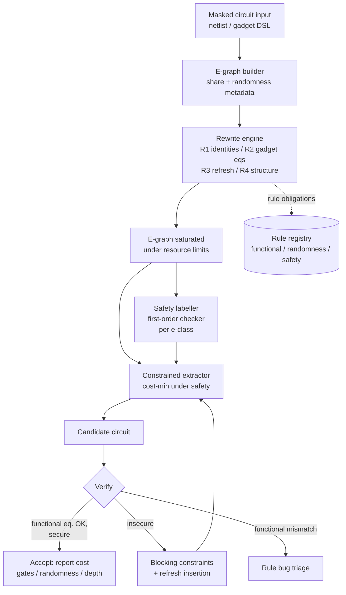

# Probing-Secure Equality Saturation
## Security-Constrained E-Graph Optimization of Masked Cryptographic Circuits

**Working system name:** SecureEqSat
**Document type:** Review 1 proposal — scope, novelty claim, prior-art analysis, feasibility, plan
**Status:** Verified preliminary; prior-art claims audited against primary sources (see §10.4)

---

# 1. Project Title

**Probing-Secure Equality Saturation: Security-Constrained E-Graph Optimization of Masked Cryptographic Circuits**

---

# 2. Executive Summary

Masking is the standard software/hardware countermeasure against side-channel attacks: a secret is split into several random-looking *shares*, and every intermediate value in the circuit must remain statistically independent of the secret. Producing a masked implementation that is both secure and cheap, however, is still largely a manual or fixed-pipeline process. Existing automated tools either *generate* masked circuits with a fixed library of gadgets, or *verify* that a circuit someone else built is secure. Nobody uses equality saturation — the e-graph–based search technique that eliminates phase-ordering problems in compilers — to *search the space of functionally equivalent masked circuits subject to a probing-security constraint*.

This project proposes SecureEqSat: an equality-saturation system whose rewrite search is governed by a probing-security oracle, and whose extraction step is constrained to select only secure circuits. The core research question is not "can e-graphs be used for security" — they can, for verification — but **can equality saturation be made sound and useful for optimization when the property that must be preserved is a global probabilistic security property rather than an algebraic congruence**.

The project is deliberately scoped to first-order probing security of straight-line Boolean masked circuits (gadgets such as ISW/DOM AND, refresh, and small masked S-box components), where the security model is well understood, checkable with existing tools, and small enough to prototype rapidly. Higher orders and composability notions (SNI/PINI) are treated as a stretch goal and discussed as future work.

**Primary deliverables:** a formal account of why standard equality saturation is unsound for probing security; a security-constrained extraction algorithm; a working prototype; and an evaluation of whether constrained e-graph search yields cheaper secure masked circuits than fixed gadget constructions.

---

# 3. Overview

## 3.1 Plain-English Overview

Cryptographic code leaks secrets through *timing* and *power*, and the standard defense is *masking*: instead of storing a secret value `x`, the program stores two (or more) random-looking pieces `x0` and `x1` such that `x0 ⊕ x1 = x`. Each piece alone tells an attacker nothing. A masked circuit is *secure* if **every intermediate wire** still tells the attacker nothing about the secret, even though the final answer obviously depends on it.

The hard part is that masking must survive *optimization*. A compiler (or a human) that simplifies `x0 ⊕ x1` into `x` — a perfectly valid Boolean simplification — immediately leaks the secret. Security and "make the circuit smaller" pull in opposite directions, and which optimizations are safe depends on the entire circuit, not on the local expression being rewritten.

Equality saturation is a compiler technique that avoids having to commit to an order of optimizations: it stores *all* equivalent forms of a program at once in a data structure called an e-graph, and at the end picks the cheapest one. This project asks: **what happens if we point that search at masked circuits and refuse to accept any output that is not provably secure?** The answer is not obvious — equality saturation is designed around *functional* equivalence, and security is not a functional property. The project builds the machinery to make the two coexist, and measures whether it finds better masked circuits than the fixed recipes people use today.

## 3.2 Technical Overview

We model a masked circuit as a Boolean circuit in an e-graph whose leaves are share-variables, public inputs, and fresh randomness, and whose nodes are `AND`, `XOR`, and `NOT`. Rewrite rules generate functionally equivalent circuits. A security oracle — first a built-in symbolic simulator, later cross-checked against established tools — decides whether a given materialized circuit is first-order probing secure. The central technical object is a **safety labelling of e-classes**: a class is *safe* if the Boolean function it represents is independent of the secrets under the masking distribution. Because functionally equal terms have equal distributions, this label is a genuine property of the class, not of a particular term. Cost-optimal extraction, however, can still choose to materialize an unsafe class as an internal wire, so we define **security-constrained extraction**: select one term per e-class minimizing gate/randomness cost such that every internal e-class used in the extracted DAG is safe and the root(s) are the intended outputs. For higher orders, joint independence is a property of *sets* of wires (a hyperproperty), which we handle with a lazy verify-and-refine (CEGIS-style) loop in which the security checker acts as a separation oracle.

The project lives at the intersection of two mature literatures that have barely met: equality saturation (compiler design) and masked-circuit optimization (hardware security). The closest existing work, superVer (EGRAPHS 2024), already uses e-graphs for probing-security *verification*; this project is about *optimization under that constraint*, which is a different algorithmic problem.

---

# 4. Problem Statement

**Given:** a masked Boolean circuit or gadget specification over secret shares, fresh randomness, and public inputs; a first-order probing-security model; and a cost model (gate count, fresh-randomness count, depth).

**Find:** a functionally equivalent circuit of lower cost that is probing secure.

**Core difficulty:** equality saturation is sound for *functional* equivalence but not for *security*:
1. Standard e-graph extraction minimizes cost with no notion of security, so the cheapest extracted circuit may be insecure even when every rewrite was functionally valid.
2. The security property is probabilistic and (for orders ≥ 2) jointly determined over sets of wires, so it cannot be encoded as an e-class semilattice analysis of the kind e-graph libraries provide.
3. Some of the most valuable masking optimizations (refresh removal, randomness reuse, gadget substitution) are not pure Boolean identities and therefore need a carefully justified rule taxonomy.

**Research question:** *Can equality saturation be augmented with a security oracle and a constrained-extraction procedure so that it explores the space of masked circuit rewrites soundly and finds measurably cheaper probing-secure implementations?*

---

# 5. Motivation

- **Masking is error-prone and expensive.** Hand-written masked implementations are a recurring source of vulnerabilities; automated generation (Tornado, AGEMA, COMPRESS) exists precisely because manual masking fails. Cost (especially fresh randomness and area) is the main barrier to adoption.
- **Security-aware optimization is an active but methodologically narrow field.** Existing automated masking tools use fixed gadget libraries, type-directed insertion, BDD/ANF decomposition, or constraint solvers. Equality saturation offers a *non-destructive, order-independent search* that none of them use, and which has repeatedly produced surprising results in adjacent domains (datapath synthesis, logic synthesis, FHE circuit synthesis).
- **E-graphs are the student team's existing research context.** The team has already studied equality saturation, extraction, and e-graph tooling, and has side-channel/leakage-model background (LLVM IR pipelines, timing leakage tooling). This is a small pivot from existing work rather than a new field.
- **A concrete, honest gap exists.** The combination "equality saturation + probing-security *optimization*" is unclaimed; the combination "equality saturation + probing-security *verification*" is claimed by a single workshop work-in-progress (superVer). The distinction is real but must be stated precisely.

---

# 6. Objectives

## 6.1 Primary Objectives

1. **Formalize the mismatch.** Give a precise account, with counterexamples, of why functional equivalence and probed-value independence diverge, and characterize which equality-saturation operations are and are not sound for first-order probing security.
2. **Build a security oracle suitable for a search loop.** Implement a first-order probing-security checker for straight-line masked Boolean circuits, validated against at least one independent established tool.
3. **Design security-constrained extraction.** Define and implement an extraction procedure that minimizes cost subject to every materialized internal wire being safe, with a lazy verify-and-refine loop for joint (higher-order) constraints.
4. **Demonstrate and evaluate.** Show that unrestricted extraction can produce insecure circuits, that constrained extraction restores security, and measure the cost (gates, randomness, depth) of the secure circuits found versus fixed-gadget baselines.
5. **Report the result honestly, including a null result.** If the security constraint leaves little optimization freedom, that is a characterization finding about the limits of e-graph-based masking optimization, not a failure.

## 6.2 Secondary / Stretch Objectives

- Extend from first-order to t-order probing security in the extraction loop.
- Support composability notions (SNI/PINI) and robust (glitch-extended) probing.
- Incorporate freshness/randomness reuse as an explicit rewrite class with proofs.
- Scale from gadgets to a masked S-box or a small cipher component.

## 6.3 Explicit Non-Objectives

- We are **not** building a production masking compiler or a replacement for Tornado/AGEMA/COMPRESS.
- We are **not** claiming a new side-channel attack or attack model.
- We are **not** aiming at glitch-extended/hardware-robust security in the first prototype (though the rule taxonomy will be designed not to preclude it).

---

# 7. Background and Preliminaries

## 7.1 Boolean Masking and the Probing Model

A secret bit `a` is encoded into `d` shares `a0, …, a_{d-1}` with `a = a0 ⊕ a1 ⊕ … ⊕ a_{d-1}`, where the shares are uniformly random subject to that constraint (for `d = 2`: `a0` uniform, `a1 = a0 ⊕ a`). Fresh random bits are additional uniform independent variables.

**t-probing adversary / t-probing security.** The adversary may observe the values carried by at most `t` wires/intermediate values of the circuit (for fixed public inputs, over the randomness of masking and fresh randomness). The circuit is *t-probing secure* if the joint distribution of the observed `t` values is independent of the secrets. For `t = 1` (first-order), the requirement is that **no single intermediate value depends on the secrets**. First-order security is the canonical, tractable entry point and is the scope of this project's core.

**Gadget examples (verified):**

| Gadget (d = 2) | Structure | Cost |
|---|---|---|
| ISW AND | `c0 = a0b0 ⊕ r`, `c1 = a0b1 ⊕ a1b0 ⊕ a1b1 ⊕ r` | 4 AND, 4 XOR, 1 random |
| DOM AND | domain-separated masked AND with registers | 4 AND, 4 XOR, 2 registers, 1 random |

Compositional security notions — non-interference (NI), strong non-interference (SNI), and probe-isolating non-interference (PINI) — are what make gadgets safe to compose; SNI/PINI are the standard target of modern masking flows and are listed as stretch scope here.

**Why this is subtle for compilers.** In the e-graph, two terms are *equal* if they compute the same Boolean function. But `c0 ⊕ c1 = ab` (the unmasked secret product). So the e-class of the pair of output shares has a representative that is the secret. Materializing that representative as an internal wire is a security violation, even though the rewrite is functionally correct. This is the phenomenon the project is built around.

## 7.2 Equality Saturation and E-Graphs

Equality saturation represents a program as an e-graph: a union-find of e-classes (equivalence classes of terms) containing e-nodes (function applications) that point to child e-classes. Rewrite rules add equivalences without deleting the original term, so rule application is **non-destructive** and **order-independent**; the e-graph compactly represents exponentially many equivalent programs. When saturation (or a resource limit) is reached, an **extraction** procedure selects a representative term from each relevant e-class, minimizing a cost function. Extraction is NP-hard in general (DAG-aware extraction is the hard case); practical systems use greedy fixed-point extraction, ILP, or stochastic search.

**Relevant limitations of mainstream tooling (verified):**

- `egg` (Rust): `Analysis` data must be a per-e-class join-semilattice with a cheap `merge` and a `make` that sees only child data. There is no facility for a global, probabilistic, or set-valued property.
- `egglog` / `egglog-python`: Datalog-style relations can express global facts and are a better fit for relational/global constraints, but the security predicate still has to be computed and enforced by us, not by the engine.
- Extraction cost functions are assumed local and monotone; the probing-security predicate is neither.

## 7.3 The Core Tension: Why Functional Equivalence Is Not Security

**Worked counterexample (first-order, d = 2).**

Take the two shares of a secret: `w1 = a0 ⊕ r`, `w2 = a1 ⊕ r`, where `r` is fresh uniform randomness. Individually, each wire is uniformly distributed and independent of `a = a0 ⊕ a1`; this pair is a secure masking of `a`.

Now apply the functionally valid Boolean rewrite `w1 ⊕ w2 → (a0 ⊕ r) ⊕ (a1 ⊕ r) → a0 ⊕ a1 → a`. The resulting wire carries `a`, the secret, and is a first-order violation. The rewrite is an instance of associativity, commutativity, and involution (`r ⊕ r = 0`) — precisely the kind of rule set an equality-saturation engine is designed to run to saturation.

**Consequence for extraction.** Because e-classes are function-level, the *class* of `w1 ⊕ w2` is the class whose function is `a` (and is secret-dependent). The original circuit never materializes it, but a cost-optimal extraction can. Therefore:

> **The set of safe circuits is a subset of the set of functionally equivalent circuits that saturation represents, and choosing a secure member requires a constraint that standard equality-saturation extraction does not have.**

## 7.4 First-Order Safety Is a Class Property — and Why That Helps

For `t = 1`, whether a wire value is independent of the secrets is a property of the Boolean function the wire computes, evaluated under the masking distribution. Since all terms in an e-class compute the same function, **first-order safety is well-defined per e-class**. This is good news for tractability and is a key design insight:

- It means first-order safety can be represented as a *label* attached to each e-class, rather than requiring search over term alternatives.
- If a class is labelled unsafe, no term choice can make it safe, so extraction must simply avoid materializing it internally.
- The label is still not an `egg`-style semilattice analysis: independence is probabilistic and requires knowledge of the masking distribution (share correlations, uniformity of randomness), not just child labels. Computing it needs symbolic/probabilistic reasoning over the class's function.

For `t ≥ 2`, safety is joint over sets of wires and is therefore *not* a per-class property — it is a hyperproperty. This is the genuinely hard case and motivates the lazy separation-oracle design in §9.4.

**This two-part structure — local per-class for first order, set-valued for higher orders — is itself part of the project's technical contribution.** It is a more accurate framing than the common shorthand that "security is not congruence-closed."

---

# 8. Literature Survey

## 8.1 Masked Circuit Generation and Optimization

| System | Venue (verified) | What it does | Security method | Uses EqSat? |
|---|---|---|---|---|
| ISW private circuits | CRYPTO 2003 | Original masked-circuit compiler | Proof | No |
| Threshold implementations (non-completeness/uniformity) | ICICS 2006 / AFRICACRYPT 2014 | Structural masking for hardware | Structural conditions | No |
| maskComp / SNI masking compiler | ACM CCS 2016 | Type-directed refresh insertion | SNI type system | No |
| Usuba | PLDI 2019 | Bitsliced cipher compiler | Constant-time (no masking) | No |
| Tornado | EUROCRYPT 2020 | Masked bitsliced C generation; tightPROVE+ verification; refresh-placement search | t-probing / register-probing, proof or attack | No |
| DATE 2021 industrial MCU masking | DATE 2021 | Gadget-based substitution of sensitive machine code | Gadget-local proofs + TVLA | No |
| AGEMA | TCHES 2022 | Unprotected netlist → PINI-masked netlist; BDD/ANF decomposition | PINI | No |
| GHPC | TCHES 2022 | Generic first-order gadget construction | Glitch-robust composable | No |
| HPC1–3 | IEEE TC 2021 / CCS 2022 | Domain-specific PINI gadgets | PINI, robust probing | No |
| Feldtkeller et al. randomness optimization | ePrint 2022/882 | MLIR-based EDA flow; randomness reuse across gadget compositions | SNI/PINI proof | No (MLIR, not e-graphs) |
| POMMES / CoMEMS | TCHES 2024 / TCHES 2026 | Security-aware register allocation for masked software | CPU-independent leakage model, PINI | No |
| COMPRESS | TCHES 2024 | Gadget selection + scheduling + replication as constraint optimization (OR-tools) | Pipelined HPC/PINI argument | No |
| Cardinal RPC masked compiler | ASIACRYPT 2025 | Random-probing-secure compiler via gadget/permutation selection | Random probing composability | No |
| Rosita / Rosita++ | NDSS 2021 / ePrint 2021/1181 | Leakage-emulator-driven assembly rewriting | Empirical (emulator + TVLA) | No |
| Eldib & Wang | CAV 2014 | SAT-based synthesis of perfectly masked code | Statistical-independence constraints | No |
| MaskedHLS | arXiv 2407.11806 | HLS with glitch-stopping register insertion/retiming | TVLA | No |
| TETRIS | ePrint 2026/1306 (existence verified only) | Design-space exploration over PINI gadgets under randomness/latency constraints | PINI | No |

**Reading:** the field is methodologically rich, but its search mechanisms are fixed libraries, type systems, BDD/ANF decomposition, constraint programming, and SAT. None uses non-destructive equality saturation with extraction.

## 8.2 Probing-Security Verification

| Tool | Venue | Input | Order | Open source |
|---|---|---|---|---|
| maskVerif | ESORICS 2019 | SSA pseudo-code / Verilog | any t | Yes (GPL family) |
| tightPROVE | ASIACRYPT 2018 | `in`/`xor`/`and`/`ref` straight-line format | any t, sound & complete | Yes (GPLv3) |
| tightPROVE+ | in Tornado, EUROCRYPT 2020 | register-based circuits | any t + register probes | With Tornado |
| IronMask | IEEE S&P 2022 | gadget formalism | any t, probing + random probing | Yes (GPLv3) |
| SILVER | ASIACRYPT 2020 | gate-level netlist | any d (probing/NI/SNI/PINI) | Yes |
| PROLEAD / PROLEAD_SW | TCHES 2022 / CHES 2023 | netlist + config | any d, simulation-based | Yes (BSD-3) |
| REBECCA | EUROCRYPT 2018 | Verilog + labelling | any d | Yes (Apache-2.0) |
| Coco / CocoAlma | USENIX 2021 / FMCAD 2021 | masked asm + CPU netlist | any order | Yes |
| VERICA | TCHES 2022 | gate-level netlist | any d, SCA + FIA | Yes |
| scVerif | TCHES 2021 | assembly + leakage DSL | any t | Yes |
| VerifMSI / LeakageVerif | (Python; used by Brakerski et al.) | gate/register circuit, Python API | t-probing, NI/SNI/PINI, glitches | Yes (GPLv3 for VerifMSI) |
| VRAPS | CRYPTO 2020 | gadgets/circuits | random probing | Yes |

**Reading:** verification is a solved-enough problem to serve as an oracle. This is what makes the project feasible: we do not need to invent a security checker, only to integrate one into a search loop.

## 8.3 E-Graphs for Hardware and Circuit Optimization

- **Datapath:** `dpopt`/constraint-aware e-graphs (Coward, Constantinides, Drane, arXiv 2303.01839; TCAD 2024) — the `ASSUME` operator encodes sub-domain branch constraints inside the e-graph.
- **Logic synthesis:** E-Syn (ICCAD 2024), BoolE (arXiv 2504.05577), E-morphic (arXiv 2504.11574), ROVER (arXiv 2406.12421), HECTOR (ICCAD 2022).
- **FHE circuits:** Cut Tracing with E-Graphs (EGRAPHS 2025, arXiv 2506.12883).
- **Colored e-graphs:** Singher & Itzhaky (arXiv 2305.19203) — multiple congruences under assumptions.
- **Crypto-adjacent:** superVer (EGRAPHS 2024, WIP) — e-graphs to verify probabilistic independence (threshold probing security) of a *given* system of expressions; **verification only**.

**Reading:** e-graphs are established in circuit optimization, and constraint-aware/colored e-graphs establish that *conditional, non-congruence-closed side conditions* can be represented. Neither has been applied to masked-circuit optimization.

## 8.4 Constraint-Aware and Colored E-Graphs

These are the closest methodological precedents for putting a non-algebraic condition into an e-graph. `ASSUME` nodes encode branch conditions; colored e-graphs maintain multiple equivalence relations under assumptions. Our security constraint is a *probabilistic global property*, which is strictly harder: it is not an assumption-guarded algebraic side condition, and for `t ≥ 2` it is a property of sets of classes. This literature is both a resource (proof that e-graphs can carry extra structure) and a prior-art boundary we must cite.

---

# 9. Limitations of Existing Systems

1. **Fixed gadget libraries** (Tornado, AGEMA, HPC, COMPRESS) constrain the solution to a pre-approved design space. They cannot discover a non-obvious equivalent circuit that mixes constructions or removes a refresh the library does not consider.
2. **Constraint solvers/SAT** (Eldib & Wang, COMPRESS) handle the security constraint but do not exploit the equality structure of Boolean algebra or the e-graph's compact representation of exponential search spaces, and they are applied to specific formulations.
3. **Type-directed insertion** (maskComp, SNI) inserts refreshes where typing fails; it does not search for cheaper secure circuits.
4. **Empirical rewriting** (Rosita) uses fixed rules until a leakage emulator is satisfied; no equality saturation, no probing proof.
5. **Verification tools** (maskVerif, tightPROVE, SILVER, …) check a circuit; they do not propose a better one. In particular superVer shows e-graphs can *verify* probing security, but not *optimize* under it.
6. **E-graph hardware work** (E-Syn, BoolE, E-morphic, RTL datapath) optimizes Boolean circuits for area/delay without any masking or leakage model.

The specific unaddressed combination: *non-destructive equality-saturation search of masked circuits with the probing-security constraint governing rules and extraction.*

---

# 10. Proposed System

## 10.1 Language and Representation

**Wire classes:** each wire carries one of:
- a share of a named secret (`a0`, `a1`, …),
- a public input,
- a fresh randomness bit (`r0`, `r1`, …),
- a constant (`0`, `1`).

**Operators:** `XOR`, `AND`, `NOT` (or a NAND basis), plus metadata linking shares to their secret identity and tracking the intended outputs.

**Masked-circuit IR:** an e-graph in which:
- leaves are the wire classes above;
- `RAND` nodes are explicit, so that randomness consumption is counted and cannot be silently duplicated or dropped;
- a *probe-safety label* is attached to each e-class (see §10.3);
- gadget boundaries (ISW/DOM patterns) are recognized by pattern-matching on e-nodes so that gadget-level rules can fire.

**Two integration options, decided by prototyping:**
- **Primary (fast prototype):** `egglog-python` (`egglog` PyPI package) — Python AST classes, `rewrite(...).to(...)`, `saturate()`, `extract()`; Datalog relations available for global bookkeeping.
- **Secondary (performance / control):** `egg` (Rust) with a custom `Applier` that gates rule applications through the security oracle and a custom extraction driver.

## 10.2 Rewrite Rule Taxonomy

Rules are partitioned by *why* they are safe, because the security oracle must treat them differently:

**Class R1 — Functional identities on safe subterms.** Associativity, commutativity, involution (`x ⊕ x = 0`), identity/annihilator for XOR/AND, De Morgan where applicable. These preserve the function but may create unsafe classes; the security gate is what makes them usable.

**Class R2 — Gadget equivalences.** Pattern-level replacements among secure gadget realizations (e.g., ISW-AND ≡ DOM-AND as wire-level functions), each with an explicit proof obligation that the replacement preserves the class-level safety labels and the randomness accounting.

**Class R3 — Refresh insertion/removal.** Refresh gadgets re-randomize a masked value. Inserting a refresh can *restore* safety to an otherwise unsafe intermediate; removing one reduces cost but risks safety. These are the highest-value and highest-risk rules; each removal must be discharged by the oracle on the extracted candidate, and each insertion must not alter the function.

**Class R4 — Structural sharing and redundancy elimination.** Common-subexpression reuse, DAG compaction, duplication removal. These mainly affect cost and fanout; the oracle runs on the result.

Every rule carries: a functional-correctness obligation (Boolean identity or gadget proof), a randomness-accounting obligation (RAND nodes explicitly preserved or explicitly justified), and a safety obligation (checked at extraction). **No rule is admitted to the engine without all three documented.**

## 10.3 Security Semantics and the Safety Label

For first-order probing security, define for each e-class `c`:

> `safe(c) = true` iff the Boolean function represented by `c`, evaluated with shares uniformly distributed subject to their sum constraints and freshness uniformly and independently distributed, is independent of every secret.

Implementation:
1. **Built-in checker (primary):** symbolic/exhaustive simulation. Enumerate assignments to the `k` randomness bits (small in gadgets), and check that for every wire's Boolean function `f`, the distribution of `f` is invariant under flipping the secret. For a straight-line circuit this is `O(#wires · 2^k · 2)` per secret — tractable at gadget scale.
2. **Independent oracle (validation):** cross-check labels/verdicts against VerifMSI (Python) and/or tightPROVE (straight-line format) on all fixtures and sampled candidates. Disagreements are treated as bugs until explained.
3. **Fixtures:** ISW AND and DOM AND must be `safe`; the deliberately broken circuit from §7.3 (`w1 ⊕ w2 → a`) must be `unsafe`.

**Important honest caveat:** the first-order per-class framing assumes the standard glitch-free probing distribution. Robust/glitch-extended probing changes the probe units (gate input cones) and is out of core scope; the design will not preclude it, but no claims will be made for it in Review 1.

## 10.4 Security-Constrained Extraction

Standard extraction: minimize `cost(term)` over term choices, ignoring safety. Our procedure:

**First-order (local per-class constraint):**
1. Extract cost-optimal candidate ignoring security.
2. Every internal e-class materialized in the DAG must satisfy `safe(c)`. Attach safety as a hard admissibility constraint in the extractor (skip unsafe nodes when computing costs / selecting terms).
3. If the root is the intended output, it is exempt from the internal-safety requirement; all other materialized classes must be safe.
4. Re-extract; verify the candidate end-to-end with the checker and an independent oracle.

**Higher-order (joint constraint; stretch):**
- Joint `t`-probing security is a property of *sets* of wires and is not per-class. Encode it as a lazy constraint loop (CEGIS style):
  1. Extract the cheapest candidate satisfying all known constraints.
  2. Run the exact `t`-order checker (separation oracle).
  3. If secure, accept. If a violating probe set is found, generate a blocking constraint (e.g., "these classes cannot be materialized together" / "this class choice must be replaced by a refreshed variant") and re-extract.
  4. Iterate to a bound; report if no secure candidate is found.
- This turns the checker into an oracle inside extraction and is itself a candidate contribution: **constrained extraction with a probabilistic hyperproperty as the constraint.**

## 10.5 End-to-End Algorithm

```text
input:  masked circuit C0 (netlist or gadget spec),
        security order t, cost model k
output: masked circuit C* with cost_k(C*) minimized s.t. secure_t(C*)

1. Build e-graph E from C0; attach secret-share/randomness metadata.
2. Saturate E with rule classes R1–R4 under a scheduler and resource limits.
3. Label e-classes: safe(c) via built-in checker; validate sample against oracles.
4. Extract candidate C ← constrained_extract(E, k, safe)         # §10.4
5. Verify: functional equivalence(C0, C) and secure_t(C) via oracle.
6. If secure: return best-known; if insecure: add blocking constraints, goto 4.
7. Report cost, e-graph statistics, and search trace.
```

---

# 11. Novelty and Innovation

## 11.1 Precise Novelty Claim

> **SecureEqSat is, to our knowledge, the first system to use equality saturation to *optimize* masked cryptographic circuits under a probing-security constraint. Its contribution is not the use of e-graphs in side-channel reasoning — that has been done for verification — but the algorithmic problem of *security-constrained e-graph extraction*: selecting a cost-minimal circuit from an e-graph when the admissible set is defined by a probabilistic independence property that is a per-class label at first order and a set-valued hyperproperty at higher orders.**

Supporting sub-claims:
1. A formal characterization of functional equivalence vs. probed-value independence, with counterexamples, and the observation that first-order safety is a per-class property while higher-order safety is not.
2. A constrained-extraction procedure for first-order safety (per-class admissibility) and a lazy separation-oracle procedure for `t ≥ 2`.
3. A rule taxonomy (R1–R4) that separates functional, randomness-accounting, and safety obligations.
4. An empirical answer to whether constrained e-graph search finds cheaper probing-secure circuits than fixed gadget constructions.

## 11.2 What We Do **Not** Claim

To keep the novelty claim defensible, these are explicitly disclaimed:

- **We are not the first to use e-graphs for probing security.** **superVer** (Treff, Pauls, Orlt, Gourjon; EGRAPHS 2024, work-in-progress) uses equivalence graphs to verify probabilistic independence — i.e., to check a given system of expressions. It performs no extraction/optimization and presents no search under the constraint.
- **We are not the first to optimize masked circuits under a security constraint.** Rosita (rewriting + leakage emulator), Eldib & Wang (SAT synthesis of masked code), AGEMA (BDD/ANF gadget decomposition), COMPRESS (constraint-programming gadget selection/scheduling), the MLIR-based randomness-reuse flow (ePrint 2022/882), TETRIS (design-space exploration), and Tornado's refresh-placement search all do constrained optimization of masked circuits through different mechanisms.
- **We are not the first to put non-congruence-closed conditions into e-graphs.** Constraint-aware e-graphs (`ASSUME`, Coward et al.) and colored e-graphs (Singher & Itzhaky) establish that. Our condition is probabilistic and global, which is different, but the general idea of extra structure in an e-graph is prior art.
- **We are not claiming a new security model or checker.** We use established first-order probing semantics and existing verification tools; the in-house checker exists only to be fast enough for the search loop, and is validated against those tools.

## 11.3 Closest Prior Art and Differentiation

| Closest work | What it does | Why it does not subsume us |
|---|---|---|
| superVer (EGRAPHS 2024) | EqSat/e-graph verification of probabilistic independence | Verification of a fixed design, no search, no extraction, no cost optimization, no rule-gated rewrite loop |
| Tornado (EUROCRYPT 2020) | Refresh placement search + tightPROVE+ inside a fixed Usuba pipeline | Local refresh-placement search, not global equality saturation; no e-graphs |
| AGEMA / COMPRESS / TETRIS | Netlist→gadget transformation / gadget selection under constraints | Fixed decomposition or constraint programming, no equality saturation; does not explore Boolean-equivalent circuits |
| Rosita (NDSS 2021) | Rule-based rewriting until leakage emulator is clean | Fixed rewrite rules, empirical leakage oracle, no e-graph, no probing proof, no cost-minimal extraction |
| Eldib & Wang (CAV 2014) | SAT-based synthesis of perfectly masked code | SAT search for one formulation; no equality classes, no phase-ordering-free exploration |
| Constraint-aware / colored e-graphs | Extra structure in e-graphs | Algebraic/branch-assumption conditions, not probabilistic security; no masking |

## 11.4 Falsification Record (What We Searched For and Did Not Find)

This claim was attacked deliberately, with the following searches and checks:

1. Direct queries for `equality saturation`/`e-graph` × `masking`/`probing security`/`threshold implementation`/`shares`/`side-channel`/`leakage`/`fault injection` (30+ query formulations).
2. Searches through EGRAPHS 2023–2025 programs for any security/masking paper; found superVer (2024) and eVer (successor, ePrint 2026/208, verification framing), plus Cut Tracing (FHE, different constraint) and Scrambler (MBA obfuscation, no shares/probing).
3. Searches of masked-optimization literature for any e-graph/EqSat usage; found none (all fixed-library/type/SAT/CP/BDD).
4. Searches for security-constrained rewriting of masked code; found Rosita (fixed rules, empirical) but no e-graph.
5. Search for constraint-aware/colored e-graphs as the methodological precedent; found Coward et al. and Singher–Itzhaky (no security property).

**Residual uncertainty:** superVer's full text is not public (WIP talk), and eVer's PDF was not retrievable; characterizations rest on the official EGRAPHS listing and the ePrint abstract. The claim is a negative result and is auditable from the query list. **Confidence: novelty approximately 6/10 as of this writing**, with the main risk being that superVer's unpublished successor adds an optimization/extraction component.

---

# 12. Prior-Art Comparison Matrix

| System | EqSat / e-graphs | Masked circuits | Probing constraint | Optimization | Search mechanism | Output |
|---|---|---|---|---|---|---|
| **SecureEqSat (proposed)** | **Yes** | **Yes** | **Yes (constrains search + extraction)** | **Yes** | **Equality saturation + constrained extraction** | **Lower-cost secure circuit** |
| superVer 2024 | Yes | Yes | Yes (verification) | No | EqSat saturation for proof | Security verdict |
| eVer 2026 (abstract) | ? (verification framing) | Yes | Yes | No | Proof rule / verification | Security verdict |
| Tornado 2020 | No | Yes | Yes | Yes (refresh placement) | Exhaustive/greedy local search + tightPROVE+ | Masked bitsliced C |
| AGEMA 2022 | No | Yes | PINI | Yes (gadget mapping) | BDD/ANF decomposition | Masked netlist |
| COMPRESS 2024 | No | Yes | PINI/HPC | Yes (area at fixed latency) | OR-tools constraint optimization | Masked Verilog pipeline |
| Feldtkeller et al. 2022 | No | Yes | SNI/PINI | Yes (randomness reuse) | MLIR EDA passes | Masked circuit |
| Rosita 2021 | No | Yes | Empirical leakage | Yes (rewriting) | Fixed rule engine | Leakage-reduced asm |
| Eldib & Wang 2014 | No | Yes | Statistical independence | Yes (synthesis) | SAT | Masked code |
| POMMES/CoMEMS 2024/26 | No | Yes (SW) | CPU leakage model / PINI | Yes (register allocation) | Constrained linear scan | Masked assembly |
| E-Syn/BoolE/E-morphic | Yes | No | No | Yes (logic area/delay) | EqSat + logic synthesis | Optimized Boolean circuit |
| Constraint-aware / colored e-graphs | Yes | No | Non-congruence side conditions | Yes (datapath) | EqSat + assumptions | Optimized datapath |
| Cut Tracing 2025 | Yes | No (FHE) | FHE cost | Yes (MC/MD tradeoff) | EqSat | FHE circuit |

---

# 13. System Architecture and Workflow



**Flow narrative.** The input circuit is lifted into an e-graph with explicit share/randomness metadata. The rewrite engine saturates under a scheduler and limits. The safety labeller annotates e-classes using the built-in first-order checker. The constrained extractor computes a cost-minimal candidate whose materialized internal classes are all safe. The verifier runs functional equivalence and the external security oracle; failures add blocking constraints (and may insert refreshes) and loop back to extraction. Accepted candidates are reported with cost and search statistics. The rule registry is the trust boundary: every rule must carry its three obligations before entering the engine.

**Data formats:** masked netlist as JSON (`{"wires": [...], "gates": [...], "shares": {...}, "randoms": [...]}`); a tiny Python DSL for writing gadgets; exported straight-line `in/xor/and/ref` format for tightPROVE and a Python object model for VerifMSI.

---

# 14. Tools and Technologies

| Layer | Choice | Why | Notes |
|---|---|---|---|
| Language | Python 3.12 | Fast prototyping; team fluency; AI-assisted coding | Core prototype |
| E-graph engine (primary) | `egglog-python` (PyPI `egglog`, MIT) | Whole domain in Python; rewrites + extraction; Datalog relations for global facts | Churn risk (fast major versioning) |
| E-graph engine (secondary) | `egg` (Rust, MIT) | Precise control of `Applier`/`Searcher`/scheduler; custom extraction | Used if Python engine bottlenecks |
| Security oracle (in-house) | Python symbolic/exhaustive first-order checker | Fast enough for the search loop; simple, auditable | Must be validated |
| Security oracles (independent) | VerifMSI (Python, GPLv3), tightPROVE (GPLv3) | Cross-validation; establish trust | GPL: use as external processes, do not link into MIT-licensed code |
| Benchmarks | MaskedVerifBench (46 programs); VerifMSI gadget set; REBECCA `dom_and.v`; Tornado samples; PROLEAD examples | Small, canonical, verifiable fixtures | Start with gadgets, then S-box |
| Analysis/plotting | networkx, pandas, matplotlib | DAG handling, metrics, figures | — |
| Testing | pytest | Fixtures: secure ISW/DOM, known-insecure circuits | Security fixtures are mandatory |
| Build/CI | uv or pip-tools; GitHub Actions | Reproducibility | Pin `egglog` version |

**Licensing note:** `egg`/`egglog` are MIT. VerifMSI and tightPROVE are GPLv3; treat them as external command-line oracles invoked as separate processes, and keep our engine MIT/Apache-style to avoid contamination. This is an explicit project constraint.

---

# 15. Implementation Plan and the 30% Milestone

## 15.1 The 30% Milestone (Foundation)

The 30% milestone is *not* the finished optimizer. It is the set of pieces that prove the project is real and that the central phenomenon exists:

1. **Masked-circuit representation** (Python): wires, shares, randomness, gates, JSON round-trip.
2. **First-order probing checker**: symbolic/exhaustive; returns safe/unsafe plus the offending wire.
3. **Checker validation**: ISW AND and DOM AND pass; the §7.3 broken masking fails; cross-checked against VerifMSI (or tightPROVE) on all fixtures.
4. **Demonstration of the core problem**: take a secure masking, run a small unconstrained rewrite set (associativity/commutativity/involution), extract the cost-minimal candidate, and show it is functionally correct but insecure.
5. **First-cut security gate**: label e-classes safe/unsafe; re-extract avoiding unsafe internal classes; show the secure candidate is recovered.

**One-night subset (if the deadline is hard):** items 1–4. That alone is a demonstrable, checkable 30%: representation + oracle + counterexample. Item 5 can land within the following day or two.

## 15.2 Full Build Phases

| Phase | Deliverable | Exit criterion |
|---|---|---|
| P0 — Grounding | Representation, checker, fixtures, oracle integration | All fixtures classified correctly; independent oracle agrees |
| P1 — Baseline EqSat | E-graph build + R1 rules + standard extraction | Reproduces §7.3 insecurity on demand; metrics captured |
| P2 — Constrained extraction | First-order safety gating | Every extracted candidate passes the oracle; cost delta measurable |
| P3 — Gadget rules | R2/R3 (gadget equivalence, refresh insertion/removal) | At least one case where constrained search beats the fixed construction |
| P4 — Scale + higher order | S-box-scale input; lazy `t ≥ 2` loop | Scale and time bounds characterized; stretch |
| P5 — Evaluation + writeup | Benchmark results, ablations, paper-shaped report | Reproducible scripts; figures |

---

# 16. Evaluation Plan

## 16.1 Research Questions

- **RQ1 (Phenomenon):** Does unconstrained equality saturation actually produce functionally correct but probing-insecure candidates? How often, and via which rule classes?
- **RQ2 (Soundness):** Does security-constrained extraction recover secure candidates, and does the built-in checker agree with independent oracles on every accepted candidate?
- **RQ3 (Payoff):** Relative to fixed gadget constructions and to unconstrained extraction, what does constrained search achieve in gates, fresh randomness, and depth?
- **RQ4 (Scale):** How do e-graph size, saturation time, and extraction time scale with share count/order and circuit size?
- **RQ5 (Ablation):** Which rule classes contribute the cost improvements? What happens with the security gate disabled/enabled?

## 16.2 Benchmarks

- **Tier 1 (gadgets):** ISW AND, DOM AND, refresh, NI/SNI/PINI multipliers, secmult, masked S-box variants — from MaskedVerifBench/VerifMSI.
- **Tier 2 (components):** a full masked AES S-box or 3-stage threshold S-box; possibly a bitsliced cipher fragment from Tornado/Usuba.
- **Tier 3 (stretch):** a small cipher component with composition.

Each benchmark record: original circuit, security verdict, gate counts, randomness count, depth, saturation/extraction time, e-graph size, number of extraction iterations.

## 16.3 Baselines

1. Original hand-written or library-generated gadget/circuit (ISW/DOM/HPC).
2. Unconstrained EqSat extraction (shows the security problem and the cost ceiling).
3. Fixed-gadget construction without search (Tornado/AGEMA-style, or the published reference circuit for the benchmark).
4. Optional: a simple local/greedy masking optimizer as a non-e-graph sanity baseline.

## 16.4 Metrics and Statistics

- Primary: **fresh-randomness count** and **AND count** (the standard masking cost proxies), then total gates and depth.
- Security: pass/fail per oracle; disagreement rate between in-house and external oracles (must be zero on accepted candidates; disagreements on rejected candidates investigated).
- Search cost: e-graph nodes, saturation iterations, wall-clock, extraction iterations.
- Reproducibility: fixed seeds, pinned versions, scripts per figure.

## 16.5 Threats to Validity

- **Gadget-scale results may not extrapolate** to full ciphers; mitigations: Tier 2/3, and explicit scale reporting (RQ4).
- **In-house checker could be wrong** in the same way the optimizer benefits from; mitigation: hard cross-validation with two independent oracles, and fixtures.
- **Benchmark choice determines the story**; mitigation: report all tiers and the full baseline matrix, including negative results.
- **The security constraint may simply never bind meaningfully** (see Risks).

---

# 17. Risks and Mitigations

| # | Risk | Likelihood | Impact | Mitigation |
|---|---|---|---|---|
| 1 | **Null result:** constrained search finds nothing cheaper than fixed gadget libraries | Medium | High (for the "win" narrative) | Frame as characterization (RQ2/RQ3); include gadget rules with real savings potential (refresh removal, sharing); report honestly |
| 2 | **Checker unsoundness** invalidates all accepted circuits | Low–Medium | Very High | Two independent oracles; fixture suite; zero-disagreement policy; conservative labels |
| 3 | **E-graph blowup** from XOR associativity/commutativity | Medium | Medium | Rule scheduling/backoff, resource limits, DAG-aware extraction, restrict R1 initially |
| 4 | **Extraction NP-hardness** at scale | Medium | Medium | Greedy/ILP with safety pruning; limited benchmarks; report extraction time |
| 5 | **First-order framing oversimplifies**: reviewers ask for PINI/glitch robustness | Medium | Medium | Explicit scope statement; design rules so PINI/robust extension is possible; discuss as future work |
| 6 | **superVer/eVer successor adds optimization** | Low–Medium | High (novelty) | Monitor; our constrained-extraction framing plus first-order-local/higher-order-global analysis is a different problem; be ready to reposition |
| 7 | **Functional correctness trust**: EqSat only guarantees equivalence w.r.t. rules | Low | High | Independent equivalence check on every accepted candidate; rule registry with obligations |
| 8 | **Scope creep** | Medium | Medium | Hard 30% milestone; non-objectives list; Tier gating |
| 9 | **Tooling churn** (egglog-python major versions) | Medium | Low | Pin versions; keep IR format independent of engine; egg fallback |
| 10 | **GPL contamination** from oracle tools | Low | Medium | External-process integration only; document licenses |

---

# 18. Timeline and Milestones

Assumes ~7–10 weeks with a small team; the 30% milestone is front-loaded.

| Week | Focus | Milestone |
|---|---|---|
| 1 | Representation, first-order checker, fixtures, oracle integration | **30% milestone (P0)**; counterexample demo |
| 2 | E-graph integration, R1 rules, baseline extraction | **P1**: reproduce insecurity; metrics pipeline |
| 3 | Safety labelling + constrained extraction (first order) | **P2**: all extracted candidates secure |
| 4 | Gadget rules R2/R3, refresh handling, rule registry | **P3**: first cost win over fixed construction |
| 5 | Baselines (Tornado/AGEMA-style figures), ablations | Benchmark matrix v1 |
| 6 | Scale to S-box/components; extraction performance | **P4**: scale characterization |
| 7 | Higher-order lazy loop (stretch), polish, negative results | RQ5 answers |
| 8–10 | Final evaluation, reproducibility package, write-up/paper | **P5**: report + artifact |

**Review 1 (this document):** title, novelty claim, prior-art matrix, architecture, 30% plan.

---

# 19. Team Roles

Roles are functional; a 3-person team maps naturally.

| Role | Owns | Key outputs |
|---|---|---|
| **A — Search & Extraction** | E-graph integration, rule engine, scheduler, constrained extraction | P1/P2/P3 code, extraction algorithm, RQ2/RQ5 |
| **B — Security & Semantics** | Probing model, in-house checker, oracle integration, rule obligations | P0 checker, validation report, rule registry |
| **C — Benchmarks & Evaluation** | Fixture/benchmark curation, baselines, metrics, figures, reproducibility | Benchmark matrix, RQ1/RQ3/RQ4, artifact scripts |
| **All** | Rule proofs, writing, review-1+ presentations | Proposal, report, demo |

If the team has 2 members: A and B merge ownership of search+security, C owns evaluation; if 4: split R2/R3 gadget rules from extraction.

---

# 20. Expected Contributions and Deliverables

1. **Formal contribution:** precise account of functional vs. probed-value independence; the first-order-local / higher-order-global structure; counterexamples.
2. **Algorithmic contribution:** security-constrained extraction for e-graphs (per-class admissibility at first order; lazy separation-oracle loop for `t ≥ 2`).
3. **System contribution:** SecureEqSat prototype (Python + egglog-python; egg fallback) with a rule registry, safety labeller, and constrained extractor.
4. **Empirical contribution:** benchmark matrix over masked gadgets/components comparing fixed constructions, unconstrained EqSat, and constrained EqSat, with an honest null-result outcome if applicable.
5. **Artifact:** reproducible scripts, fixtures, rule obligations, pinned environment.
6. **Review-1 package:** this document plus a 30% demonstrable prototype.

---

# 21. References

**Masking and probing security**
- Ishai, Sahai, Wagner. *Private Circuits: Securing Hardware against Probing Attacks.* CRYPTO 2003.
- Nikova, Rechberger, Rijmen. *Threshold Implementations Against Side-Channel Attacks and Glitches.* ICICS 2006.
- Bilgin, Gierlichs, Nikova, Nikov, Rijmen. *A More Efficient AES Threshold Implementation.* AFRICACRYPT 2014 (uniformity).
- Barthe, Belaïd, Dupressoir, Fouque, Grégoire, Strub. *Verified Proofs of Higher-Order Masking.* EUROCRYPT 2015.
- Barthe, Belaïd, Dupressoir, Fouque, Grégoire, Strub, Zucchini. *Strong Non-Interference and Type-Directed Higher-Order Masking.* ACM CCS 2016.
- Groß, Mangard, Korak. *Domain-Oriented Masking.* TIS@CCS 2016 / CT-RSA 2017.
- Faust, Grosso, Merino Del Pozo, Paglialonga, Standaert. *Composable Masking Schemes in the Presence of Physical Defaults.* CHES 2018 (robust probing).
- Cassiers, Standaert. *Trivially and Efficiently Composing Masked Gadgets with Probe Isolating Non-Interference.* ePrint 2018/438 / IEEE TIFS 2020.
- Cassiers, Grégoire, Levi, Standaert. *Hardware Private Circuits: From Trivial Composition to Full Verification.* IEEE TC 2021 (HPC).
- Knichel, Moradi. *Composable Gadgets with Reused Fresh Masks.* ACM CCS 2022 (HPC3).

**Masked generation/optimization**
- Mercadier, Dagand. *Usuba: High-Throughput and Constant-Time Ciphers, by Construction.* PLDI 2019.
- Belaïd, Dagand, Mercadier, Rivain, Wintersdorff. *Tornado: Automatic Generation of Probing-Secure Masked Bitsliced Implementations.* EUROCRYPT 2020.
- Abromeit et al. *Automated Masking of Software Implementations on Industrial Microcontrollers.* DATE 2021.
- Knichel, Moradi, Müller, Sasdrich. *AGEMA.* TCHES 2022.
- Moradi, Sasdrich, Knichel. *GHPC.* TCHES 2022.
- Shelton et al. *Rosita.* NDSS 2021; *Rosita++.* ePrint 2021/1181.
- Eldib, Wang. *Synthesis of Masking Countermeasures against Side Channel Attacks.* CAV 2014.
- Feldtkeller, Knichel, Sasdrich, Moradi, Güneysu. *Randomness Optimization for Gadget Compositions in Higher-Order Masking.* ePrint 2022/882.
- Cassiers, Gigerl, Mangard, Momin, Nagpal. *COMPRESS.* TCHES 2024.
- Zeitschner, Moradi. *POMMES.* TCHES 2024; *CoMEMS.* TCHES 2026.
- Belaïd, Normand, Rivain. *Masked Circuit Compiler in the Cardinal Random Probing Composability Framework.* ASIACRYPT 2025.
- Sarma, Thakur, Karfa. *MaskedHLS.* arXiv 2407.11806.

**Verification tools**
- Belaïd, Goudarzi, Rivain. *tightPROVE.* ASIACRYPT 2018.
- Barthe et al. *maskVerif.* ESORICS 2019.
- Knichel, Sasdrich, Moradi. *SILVER.* ASIACRYPT 2020.
- Bloem et al. *REBECCA.* EUROCRYPT 2018.
- Müller, Moradi. *PROLEAD.* TCHES 2022; *PROLEAD_SW.* CHES 2023.
- Gigerl et al. *Coco.* USENIX Security 2021; Hadžić, Bloem. *CocoAlma.* FMCAD 2021.
- Richter-Brockmann et al. *VERICA.* TCHES 2022.
- Barthe et al. *scVerif.* TCHES 2021.
- Belaïd, Coron, Prouff, Rivain, Taleb. *Random Probing Security / VRAPS.* CRYPTO 2020.
- Meunier et al. *VerifMSI / LeakageVerif.* (Python; GPLv3).

**Equality saturation and e-graphs**
- Tate, Stepp, Tatlock, Lam. *Equality Saturation: A New Approach to Optimization.* POPL 2009.
- Willsey, Nandi, Wang, Flatt, Tatlock, Panchekha. *egg: Fast and Extensible Equality Saturation.* POPL 2021.
- Zhang et al. *Better Together: Unifying Datalog and Equality Saturation (egglog).* PLDI 2023.
- Coward, Constantinides, Drane. *Automating Constraint-Aware Datapath Optimization using E-Graphs.* arXiv 2303.01839 / TCAD 2024.
- Singher, Itzhaky. *Colored E-Graphs.* arXiv 2305.19203.
- Treff, Pauls, Orlt, Gourjon. *superVer: Verifying Probabilistic Independence of Systems of Expressions using Equality Saturation.* EGRAPHS 2024 (WIP).
- Gourjon, Orlt, Pauls, Treff. *eVer.* ePrint 2026/208.

**E-graphs in circuits/hardware**
- E-Syn (ICCAD 2024); BoolE (arXiv 2504.05577); E-morphic (arXiv 2504.11574); ROVER (arXiv 2406.12421); HECTOR (ICCAD 2022).
- de Castelnau et al. *Cut Tracing with E-Graphs for Boolean FHE Circuit Synthesis.* EGRAPHS 2025.
- Ustun et al. *Equality Saturation for Datapath Synthesis.* DAC 2023 (invited).
- *IMpress* (HLS integer-multiplier optimization via EqSat).

---

# Appendix A — Glossary

| Term | Meaning |
|---|---|
| Masking / shares | Encoding a secret as `d` shares whose XOR is the secret |
| Probing security | Adversary observes ≤ t intermediate values; security = independence from secrets |
| First order (t=1) | No single intermediate value depends on a secret |
| Showing / shared randomness | Fresh uniform bits consumed by gadgets |
| ISW / DOM | Canonical masked-AND gadget constructions |
| NI / SNI / PINI | Composability notions under which gadgets can be safely chained |
| Equality saturation | Non-destructive rewriting to a fixed point in an e-graph |
| E-graph / e-class / e-node | Union-find of equivalent terms / an equivalence class / a function application |
| Extraction | Choosing one representative term per e-class to minimize cost |
| Congruence closure | Merging classes whose parents become equal |
| Hyperproperty | Property of sets of executions/wires (e.g., joint independence for t ≥ 2) |
| CEGIS / separation oracle | Iterative verify-and-refine loop; checker returns a witness that becomes a constraint |
| Cost model | Here: AND count, XOR count, fresh-randomness count, depth |

# Appendix B — Verification Notes and Confidence

- **Verified by direct fetch:** superVer EGRAPHS 2024 listing (verification, no optimization); Coward et al. constraint-aware e-graphs; egg/egglog-python capabilities; VerifMSI/tightPROVE/SILVER/PROLEAD/PROPEAD_SW/REBECCA/Coco/CocoAlma/VERICA/scVerif/VRAPS existence and input formats; MaskedVerifBench; Tornado/DOM gadget structures; ISW AND structure; POMMES/CoMEMS; AGEMA; COMPRESS; Feldtkeller et al.; Rosita; Eldib & Wang.
- **Abstract-only (not full text):** eVer (ePrint 2026/208, PDF 403); TETRIS (ePrint 2026/1306); superVer full text (WIP, no public PDF).
- **Negative results (auditable):** no e-graph/EqSat system found that optimizes masked circuits under probing security; no masked-circuit optimizer found that uses e-graphs. Query lists in §11.4.
- **Novelty confidence:** ~6/10, dominated by the risk that superVer/eVer's line of work adds an optimization step before this project matures.
- **Feasibility confidence:** ~medium-high for the 30% milestone and ~medium for a publishable empirical win; the single largest technical risk is constrained extraction under a non-local property, and the single largest scientific risk is a null result on cost savings.

---

# Revision Note — after the feasibility push (2026-10-06)

This document is the Plan A proposal. Its **mechanism (§10), novelty boundaries
(§11) and trust-boundary material remain valid**. The headline claim has been
revised by `design/0010` after the feasibility push; read this document together
with `docs/feasibility-report.md`.

**What the checks confirmed**

- The trust boundary is **closed**: the in-house checker agrees with VerifMSI on
  every wire of 21,760 wires across 1,216 circuits, zero violations
  (`design/0005`).
- The premise is confirmed on **two independent engines**, leaking on identical
  wires (`experiments/premise_test/RESULTS.md`,
  `experiments/egglog_port/RESULTS.md`).
- Security-constrained extraction is **implemented** and recovers a secure
  circuit from the insecure optimum (`experiments/constrained_extraction/`).
- Scalability is an engineering problem, solved by using `egglog`
  (`design/0009`).

**What changed**

- "Constrained search finds cheaper secure masked circuits" is **not supported**.
  At gadget scale the constrained optimum equals the known construction; at
  chain scale the entire sampled cheap extraction frontier is insecure.
- The explanation is the **re-sharing gap**: the optimizations worth having
  (refresh insertion/removal, randomness reuse, gadget substitution) are not
  Boolean equalities, so plain equality saturation cannot express them — and
  prefers the one refactoring it can express, which is the insecure one.

**Revised headline (per `design/0010`)**

1. Unconstrained equality saturation is **unsound** for masked-circuit
   optimization, with a concrete mechanism and two-engine reproduction.
2. The **repair**: exact cross-validated checker, per-class safety labelling,
   security-constrained extraction.
3. The **research question**: what equivalence relation should an e-graph use
   for masked circuits, given that the useful optimizations are equivalences up
   to re-sharing?

The §11 disclaimers (superVer, the masked-optimizer lineage, constraint-aware and
colored e-graphs) still apply verbatim and must appear in any write-up.
