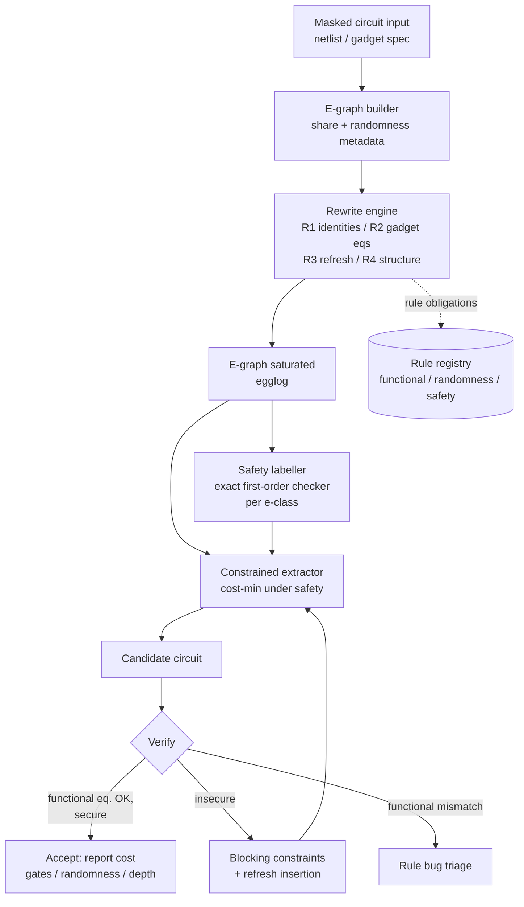

# Probing-Secure Equality Saturation
## Soundness, Repair, and the Re-sharing Gap in E-Graph Optimization of Masked Circuits

**Working system name:** SecureEqSat
**Document type:** Review 1 proposal (revision 3)
**Document history:** v1 — Plan A proposal, 2026-10-06. v2 — revised after the
feasibility push (`docs/feasibility-report.md`) per `design/0010`. v3 — corrected
after a third adversarial pass (`docs/adversarial-search-3.md`): the re-sharing
claim is restated as a **congruence obstruction** (the equivalence itself is
standard masking semantics, not a new notion), the soundness claim is sharpened
and disclaimed against MaskedHLS / FRAIG-CAD / SecCG, the repair claim is
disclaimed against eVer, and a measured **labelling bottleneck** is added to the
risks.
**Prior-art claims audited against primary sources (see §11.4); experimental
claims reproduced on two engines (see §15).**

---

# 1. Project Title

**Probing-Secure Equality Saturation: Soundness, Repair, and the Re-sharing Gap
in E-Graph Optimization of Masked Circuits**

*(Originally: "Security-Constrained E-Graph Optimization of Masked Cryptographic
Circuits". The title changed because the project's strongest verified result is
a soundness finding, not an optimization win — see §11.1.)*

---

# 2. Executive Summary

Masking is the standard software/hardware countermeasure against side-channel
attacks: a secret is split into random-looking *shares*, and every intermediate
value must remain statistically independent of the secret. Producing a secure
masked implementation that is also cheap remains largely manual or fixed-pipeline.

We asked whether **equality saturation** — the non-destructive, order-independent
rewrite search from compiler design — can optimize masked circuits. It had never
been applied to them. The answer, established experimentally in this project, is
three-fold:

1. **Apply it naively and it is unsound.** Ordinary Boolean rewriting
   (distributivity run backwards) refolds shares and materialises the unmasked
   secret; cost-optimal extraction *prefers* this because it is cheaper. We
   reproduce the effect on two independent engines, leaking on identical wires.
2. **It can be repaired.** We built an exact first-order probing checker and
   cross-validated it against an independent tool on 21,760 wires with zero
   violations; a per-class safety labelling; and security-constrained extraction
   that recovers a secure circuit from the insecure optimum.
3. **The payoff is hard for a principled reason.** The optimizations the masking
   literature actually exploits — refresh insertion/removal, randomness reuse,
   gadget substitution — are **not congruences** of the wire-level Boolean term
   algebra: they change which function each wire computes while preserving the
   shared value. An e-graph's semantics *is* a congruence, so re-sharing cannot
   be its equality relation, and guarded rules do not repair that. Plain equality
   saturation therefore prefers the one refactoring it *can* express, which is
   the insecure one. (The equivalence itself is standard masking semantics —
   ISW, SNI, tightPROVE's `Flatten`, RNI-f — so what is ours is the consequence
   for e-graph search, not the equivalence.)

**Status.** Claims 1 and 2 are demonstrated; claim 3 is a negative result with a
named route forward. The deliverable for Review 1 is the soundness finding, the
verified repair, and the gap — all backed by artefacts in `experiments/`.

---

# 3. Overview

## 3.1 Plain-English Overview

Cryptographic code leaks secrets through timing and power, and the standard
defense is *masking*: instead of storing a secret value `x`, the program stores
two (or more) random-looking pieces `x0` and `x1` such that `x0 ⊕ x1 = x`. Each
piece alone tells an attacker nothing. A masked circuit is secure if **every
intermediate wire** still tells the attacker nothing, even though the final
answer obviously depends on the secret.

The hard part is that masking must survive *optimization*. A compiler that
simplifies `x0 ⊕ x1` into `x` — a perfectly valid Boolean simplification —
immediately leaks the secret. Security and "make the circuit smaller" pull in
opposite directions.

Equality saturation is a compiler technique that avoids committing to an
optimization order: it stores *all* equivalent forms of a program at once in an
e-graph and picks the cheapest at the end. We asked what happens if you point
that at masked circuits.

**What we found:** the cheapest form is often an insecure one, by construction —
the optimization itself refolds the shares. We then built the machinery to
refuse those outputs, and measured what that costs. It works. But the
optimizations that would actually make masked circuits cheaper are not
simplifications of the *program* at all; they are re-randomizations of the
shares, which equality saturation cannot see. That gap is the project's
research question.

## 3.2 Technical Overview

We model a masked circuit as a Boolean circuit in an e-graph whose leaves are
share-variables, public inputs, and fresh randomness, and whose nodes are `AND`
and `XOR`. Rewrite rules generate functionally equivalent circuits. A security
oracle decides whether a materialised circuit is first-order probing secure.
The central technical object is a **safety labelling of e-classes**: because all
terms in an e-class compute the same Boolean function, first-order safety — the
wire's distribution being independent of the secrets — is a genuine property of
the class, not of a term. Cost-optimal extraction can nevertheless materialise
an *unsafe* class as an internal wire, so we define **security-constrained
extraction**: choose one term per e-class minimising gate cost such that every
internal materialised class is safe and the roots are the intended outputs. For
orders `t ≥ 2`, joint independence is a set-valued hyperproperty and we specify a
lazy verify-and-refine (CEGIS) loop with the checker as a separation oracle.

**Demonstrated.** On a 2-share ISW AND gadget: unconstrained extraction gives a
7-gate functionally correct but probing-**insecure** circuit (it materialises
the unmasked secret `b`); security-constrained extraction returns an 8-gate
**secure** circuit. Price of security: 1 gate. Reproduced identically on
`egglog`.

**Open.** On a two-gadget chain the hand-written composition is 16 gates and
secure; unconstrained extraction finds 14 gates and is insecure, and the entire
sampled cheap frontier is insecure. No secure improvement has been found at
either scale, and §7.5 explains why we now expect the gains to require a richer
equivalence than functional equality.

---

# 4. Problem Statement

**Given:** a masked Boolean circuit over secret shares, fresh randomness, and
public inputs; a first-order probing-security model; and a cost model (gate
count, fresh-randomness count, depth).

**Establish:** whether equality-saturation-based optimization is sound for such
circuits; if not, repair it; and determine what class of optimizations can
actually be found under the security constraint.

Three concrete sub-problems, in the order the evidence forced them:

1. **Soundness.** Standard extraction minimises cost with no notion of security,
   so the cheapest extracted circuit may be insecure even when every rewrite was
   functionally valid.
2. **Repair.** The security property is probabilistic and (for `t ≥ 2`) jointly
   determined over sets of wires, so it cannot be encoded as an e-class
   semilattice analysis of the kind e-graph libraries provide.
3. **Expressiveness.** The optimizations worth having appear not to be function
   equalities, so the e-graph may be operating at the wrong abstraction level.
   Characterising the correct equivalence is the open question.

---

# 5. Motivation

- **Masking is error-prone and expensive.** Hand-written masked implementations
  are a recurring source of vulnerabilities; automated generation exists
  precisely because manual masking fails. Cost — especially fresh randomness and
  area — is the main barrier to adoption.
- **Optimizers are an under-recognised attack surface for masking.** The result
  in §7.3 means that any agent that rewrites masked code for size or speed —
  compiler, superoptimizer, or learned model — can silently reintroduce leaks
  while remaining functionally correct. That is a security-relevant finding
  independent of whether we ever beat hand-tuned constructions.
- **The soundness question is answerable, and we have answered it.** Unlike a
  speculative "we will optimize X", the claims here are backed by artefacts:
  a cross-validated checker, a working constrained extractor, and a two-engine
  reproduction.
- **The gap is a real research question.** Re-sharing is not a congruence, so it
  cannot be an e-graph's equality relation; finding a representation that can
  carry it while keeping extraction security-aware is concrete and well posed.

---

# 6. Objectives

## 6.1 Primary Objectives

| # | Objective | Status |
|---|---|---|
| 1 | Establish whether unconstrained equality saturation is sound for masked circuits, with a concrete mechanism and counterexamples | ✅ **Done** — §7.3, reproduced on two engines |
| 2 | Build a first-order probing checker suitable for a search loop, independently validated | ✅ **Done** — cross-checked on 21,760 wires, 0 violations |
| 3 | Design and implement security-constrained extraction | ✅ **Done** — recovers a secure circuit from the insecure optimum |
| 4 | Measure the cost of the security constraint and the optimization payoff | ✅ **Measured** — 1 gate at gadget scale; **no payoff found** at gadget or chain scale |
| 5 | Explain the negative payoff result and formulate the next research question | ✅ **Done** — the re-sharing gap, §7.5 |
| 6 | Characterise re-sharing equivalence and test whether an e-graph can carry it | ⏳ **Open** — the project's forward work |

## 6.2 Secondary / Stretch Objectives

- Extend from first-order to `t`-order probing security in the extraction loop.
- Support composability notions (SNI/PINI) and robust (glitch-extended) probing.
- Incorporate freshness/randomness reuse as explicit rewrites with proofs.
- Scale from gadgets to a masked S-box or cipher component.

## 6.3 Explicit Non-Objectives

- We are **not** building a production masking compiler or a replacement for
  Tornado/AGEMA/COMPRESS.
- We are **not** claiming a new side-channel attack or attack model.
- We are **not** aiming at glitch-extended/hardware-robust security in the core
  prototype (though the rule taxonomy is designed not to preclude it).
- We do **not** claim that no useful optimization exists — only that none has
  been found at the Boolean-equality abstraction level, with an explanation.

---

# 7. Background and Preliminaries

## 7.1 Boolean Masking and the Probing Model

A secret bit `a` is encoded into `d` shares `a0, …, a_{d-1}` with
`a = a0 ⊕ … ⊕ a_{d-1}`, where the shares are uniformly random subject to that
constraint (for `d = 2`: `a0` uniform, `a1 = a0 ⊕ a`). Fresh random bits are
additional uniform independent variables.

**t-probing adversary / t-probing security.** The adversary may observe the
values carried by at most `t` wires of the circuit (for fixed public inputs,
over the randomness of masking and fresh randomness). The circuit is
*t-probing secure* if the joint distribution of the observed `t` values is
independent of the secrets. For `t = 1` the requirement is that **no single
intermediate value depends on the secrets** — the tractable, canonical entry
point and the scope of this project's core.

**Gadget examples (verified):**

| Gadget (d = 2) | Structure | Cost |
|---|---|---|
| ISW AND | `c0 = a0b0 ⊕ r`, `c1 = a0b1 ⊕ a1b0 ⊕ a1b1 ⊕ r` | 4 AND, 4 XOR, 1 random |
| DOM AND | domain-separated masked AND with registers | 4 AND, 4 XOR, 2 registers, 1 random |

**Ordering matters.** ISW is secure only when the fresh random is folded into
every intermediate of the `c1` chain. The naive XOR tree — same final function —
leaves `a0&b1 ^ a1&b0` as a leaking intermediate. Our checker caught this in our
own hand-written fixture, and it is the reason the project treats the security
property as structure-sensitive rather than a property of the output.

**Composability.** Non-interference (NI), strong non-interference (SNI), and
probe-isolating non-interference (PINI) are what make gadgets safely composable;
they are stretch scope here.

## 7.2 Equality Saturation and E-Graphs

Equality saturation represents a program as an e-graph: a union-find of
e-classes (equivalence classes of terms) containing e-nodes (function
applications) pointing to child e-classes. Rewrite rules add equivalences
without deleting the original term, so rule application is **non-destructive**
and **order-independent**. When saturation (or a resource limit) is reached,
**extraction** selects a representative term per relevant e-class, minimising a
cost function. DAG-aware extraction is NP-hard; practical systems use greedy
fixed-point extraction, ILP, or stochastic search.

**Relevant limitations of mainstream tooling (verified):**

- `egg` (Rust): `Analysis` data must be a per-e-class join-semilattice with a
  cheap `merge` and a `make` that sees only child data. There is no facility for
  a global, probabilistic, or set-valued property.
- `egglog` (Datalog + EqSat) can express global relational facts, but the
  security predicate still has to be computed and enforced by us.
- Extraction cost functions are assumed local and monotone; the probing-security
  predicate is neither.

## 7.3 The Core Tension: Why Functional Equivalence Is Not Security

**Worked counterexample (first-order, d = 2).** Take the two shares of a secret:
`w1 = a0 ⊕ r`, `w2 = a1 ⊕ r`, with `r` fresh uniform randomness. Individually
each wire is uniform and independent of `a = a0 ⊕ a1`. Apply the functionally
valid rewrite `w1 ⊕ w2 → (a0 ⊕ r) ⊕ (a1 ⊕ r) → a0 ⊕ a1 → a` — an instance of
associativity, commutativity, and involution (`r ⊕ r = 0`), precisely what an
equality-saturation engine runs to saturation. The resulting wire carries the
secret.

**Demonstrated on ISW AND.** Saturation with distributivity/factoring turns `c1`
into `r ^ a0&b1 ^ a1&(b0 ^ b1)` — 7 gates instead of 8, functionally correct,
with the **unmasked secret `b`** materialised as an internal wire. Cost-minimal
extraction selects it *because it is cheaper*. The failure is systematic, not a
corner case, and it reproduces on two independent engines with identical leaking
wires (§15).

> **Consequence.** The set of safe circuits is a strict subset of the
> functionally equivalent circuits that saturation represents, and choosing a
> secure member requires a constraint that standard extraction does not have.

## 7.4 First-Order Safety Is a Class Property — and Why That Helps

For `t = 1`, whether a wire value is independent of the secrets is a property of
the Boolean function the wire computes, evaluated under the masking
distribution. Since all terms in an e-class compute the same function,
**first-order safety is well-defined per e-class**:

- it can be represented as a *label* attached to each e-class;
- if a class is labelled unsafe, no term choice makes it safe, so extraction
  must avoid materialising it internally;
- the label is still not an `egg`-style semilattice analysis: independence is
  probabilistic and requires knowledge of the masking distribution, not just
  child labels.

For `t ≥ 2`, safety is joint over sets of wires — a hyperproperty — and is not
per-class. This two-part structure (local at first order, set-valued at higher
orders) is a technical contribution, and it is a more accurate framing than the
common shorthand that "security is not congruence-closed".

## 7.5 The Re-sharing Gap (the project's current research question)

The optimizations that the masking literature actually exploits are **not**
identities of the wire-level Boolean algebra:

| Optimization | What changes | Character of the transformation |
|---|---|---|
| Refresh insertion/removal | Re-randomises a masked value | Same shared value, different shares |
| Randomness reuse | Two gadgets share fresh randomness | A property of the **dependency / independence structure**, not of values |
| Gadget substitution | ISW ↔ DOM ↔ HPC realisations | Implementation equivalence **under a composability discipline** |

These are **not one relation**, and "same decoded value" alone is **too coarse**:
it would identify a secure `(x0, x1)` with the insecure `(x, 0)` — precisely the
unsoundness this project found. A usable relation must be **finer than the decode
kernel and security-aware**, tracking freshness and independence (as RNI-f does).

The equivalence itself is **standard masking semantics**, not a new observation:
ISW (CRYPTO 2003) relies on re-randomised outputs being *m*-wise independent;
SNI (Barthe et al., CCS 2016) states that "inserting refreshing gadgets does not
change the functional behavior"; **tightPROVE's `Flatten`** (ASIACRYPT 2018)
replaces multiplication and refresh gadget outputs with fresh input sharings of
the same value as a reduction step; randomness reuse is an entire research line
(COMAR / Feldtkeller et al., TCHES 2022; **RNI-f**, Wang et al., TCHES 2022).

**What is ours is the consequence for e-graph search.** An e-graph's semantics is
a *partial congruence relation* (Suciu, Wang, Zhang, ICDT 2025,
arXiv 2501.02413). Re-sharing is **not a congruence** of the wire-term algebra:
`x0` and `x0 ⊕ r` are different functions, and that difference survives ordinary
contexts. Guards control *when an equality fires*; they cannot make a
non-equality into an equality (`egg` and `egglog` both support guarded and
dynamic rewrites, so this is not a missing feature). Therefore:

- re-sharing **cannot be the equality relation** of a plain e-graph over wires —
  it is a representation problem, not an API gap;
- plain equality saturation **prefers the one refactoring it can express** —
  share refolding — which is exactly the insecure one.

This explains the negative payoff results in §15, and it is the sharper question:
*what representation can carry re-sharing while keeping extraction
security-aware?*

---

# 8. Literature Survey

## 8.1 Masked Circuit Generation and Optimization

| System | Venue (verified) | What it does | Security method | Uses EqSat? |
|---|---|---|---|---|
| ISW private circuits | CRYPTO 2003 | Original masked-circuit compiler | Proof | No |
| Threshold implementations | ICICS 2006 / AFRICACRYPT 2014 | Structural masking; non-completeness/uniformity | Structural conditions | No |
| maskComp / SNI masking compiler | ACM CCS 2016 | Type-directed refresh insertion | SNI type system | No |
| Usuba | PLDI 2019 | Bitsliced cipher compiler | Constant-time (no masking) | No |
| Tornado | EUROCRYPT 2020 | Masked bitsliced C; refresh-placement search | t-probing / register-probing | No |
| DATE 2021 industrial MCU masking | DATE 2021 | Gadget-based machine-code substitution | Gadget-local proofs + TVLA | No |
| AGEMA | TCHES 2022 | Netlist → PINI-masked netlist; BDD/ANF | PINI | No |
| HPC1–3 | IEEE TC 2021 / CCS 2022 | Domain-specific PINI gadgets | PINI, robust probing | No |
| Feldtkeller et al. | ePrint 2022/882 | MLIR EDA flow; **randomness reuse across gadgets** | SNI/PINI proof | No |
| POMMES / CoMEMS | TCHES 2024 / 2026 | Security-aware register allocation | CPU leakage model, PINI | No |
| COMPRESS | TCHES 2024 | Gadget selection + scheduling (OR-tools) | Pipelined HPC/PINI argument | No |
| Cardinal RPC masked compiler | ASIACRYPT 2025 | Random-probing-secure compiler | Random probing composability | No |
| Rosita / Rosita++ | NDSS 2021 / ePrint 2021/1181 | Leakage-emulator-driven assembly rewriting | Empirical (emulator + TVLA) | No |
| Eldib & Wang | CAV 2014 | SAT-based synthesis of masked code | Statistical independence | No |

**Reading.** The field is methodologically rich — fixed libraries, type systems,
BDD/ANF decomposition, constraint programming, SAT, empirical rewriting — but
none uses non-destructive equality saturation with extraction. Critically, the
rows that achieve real cost reductions (Tornado, AGEMA, COMPRESS, Feldtkeller et
al.) do so through refresh and randomness transformations, i.e. through
re-sharing, not through Boolean simplification. That observation is §7.5.

## 8.2 Probing-Security Verification

| Tool | Venue | Input | Order | Open source |
|---|---|---|---|---|
| maskVerif | ESORICS 2019 | SSA pseudo-code / Verilog | any t | Yes |
| tightPROVE / tightPROVE+ | ASIACRYPT 2018 / in Tornado | straight-line `in/xor/and/ref` | any t, sound & complete | Yes (GPLv3) |
| IronMask | IEEE S&P 2022 | gadget formalism | any t, probing + random probing | Yes |
| SILVER | ASIACRYPT 2020 | gate-level netlist | any d | Yes |
| PROLEAD / PROLEAD_SW | TCHES 2022 / CHES 2023 | netlist + config | any d, simulation | Yes |
| REBECCA | EUROCRYPT 2018 | Verilog + labelling | any d | Yes |
| Coco / CocoAlma | USENIX 2021 / FMCAD 2021 | masked asm + CPU netlist | any order | Yes |
| VERICA | TCHES 2022 | gate-level netlist | any d, SCA + FIA | Yes |
| scVerif | TCHES 2021 | assembly + leakage DSL | any t | Yes |
| **VerifMSI** | SECRYPT 2023 | gate/register circuit, Python API | t-probing, NI/SNI/PINI, glitches | Yes (GPLv3) |
| VRAPS | CRYPTO 2020 | gadgets/circuits | random probing | Yes |

**Reading.** Verification is solved enough to serve as an oracle — which is what
makes the repair in §10 feasible. **VerifMSI is used in this project as the
independent oracle** for the trust boundary (§11.4, Appendix B). We characterise
it rather than trust it: `checkTpsVal` returns a 3-tuple (so the README's
`if res:` idiom is silently always-true) and is a *sound but incomplete
certificate*; the exact function is `getDistribWithExev(...)[1]`.

## 8.3 E-Graphs for Hardware and Circuit Optimization

- **Datapath:** constraint-aware e-graphs (`ASSUME`, Coward et al., arXiv
  2303.01839; TCAD 2024).
- **Logic synthesis:** E-Syn (ICCAD 2024), BoolE (arXiv 2504.05577), E-morphic
  (arXiv 2504.11574), ROVER (arXiv 2406.12421), HECTOR (ICCAD 2022).
- **FHE circuits:** Cut Tracing (EGRAPHS 2025, arXiv 2506.12883).
- **Colored e-graphs:** Singher & Itzhaky (arXiv 2305.19203).
- **Crypto-adjacent:** **superVer** (EGRAPHS 2024, WIP) — e-graphs to *verify*
  probabilistic independence (threshold probing security) of a given system of
  expressions; **verification only**.

## 8.4 Constraint-Aware and Colored E-Graphs

The closest methodological precedents for putting a non-algebraic condition into
an e-graph. `ASSUME` nodes encode branch conditions; colored e-graphs maintain
multiple equivalence relations under assumptions. Our security constraint is
probabilistic and (for `t ≥ 2`) set-valued, which is strictly harder; these
works are both a resource and a prior-art boundary we must cite.

---

# 9. Limitations of Existing Systems

1. **Fixed gadget libraries** (Tornado, AGEMA, HPC, COMPRESS) constrain the
   solution to a pre-approved design space and cannot discover a non-obvious
   equivalent circuit outside it.
2. **Constraint solvers/SAT** handle security constraints but do not exploit the
   equality structure of Boolean algebra or the e-graph's compact representation
   of exponential search spaces.
3. **Type-directed insertion** (maskComp, SNI) inserts refreshes where typing
   fails; it does not search for cheaper secure circuits.
4. **Empirical rewriting** (Rosita) uses fixed rules until a leakage emulator is
   satisfied; no equality saturation, no probing proof.
5. **Verification tools** check a circuit rather than proposing a better one. In
   particular superVer shows e-graphs can *verify* probing security, but not
   *optimize* under it.
6. **E-graph hardware work** optimizes Boolean circuits for area/delay without
   any masking or leakage model.
7. **No existing system addresses the soundness of EqSat-based optimization of
   masked circuits** — necessary because, as §7.3 shows, the naive combination
   is unsound. Nor does any e-graph formulation express re-sharing (§7.5).

---

# 10. Proposed System

## 10.1 Language and Representation

**Wire classes:** share of a named secret, public input, fresh randomness, or
constant.

**Operators:** `XOR`, `AND`, `NOT`, plus explicit `RAND` nodes so randomness
consumption is counted and cannot be silently duplicated or dropped.

**Masked-circuit IR:**
- leaves are the wire classes above;
- a *probe-safety label* is attached to each e-class (§10.3);
- gadget boundaries (ISW/DOM patterns) are recognised by pattern-matching so
  gadget-level rules can fire.

**Engine.** `egglog-python` is the production engine (`design/0009`): the
two-gadget chain that exhausted the in-house harness (3,000-class cap in 2
iterations, 62.5 s) saturates in `egglog` in under 0.01 s. The minimal in-house
e-graph remains the falsification harness, not the product.

## 10.2 Rewrite Rule Taxonomy

| Class | Rules | Status |
|---|---|---|
| **R1 — Boolean identities** | assoc, comm, involution, identity, idempotence, annihilator, **distributivity/factoring** | Implemented. Factoring is the rule that enables both the attack and (potentially) the savings |
| **R2 — Gadget equivalences** | ISW ≡ DOM ≡ HPC realisations, with proof obligations | Specified, not implemented |
| **R3 — Refresh insertion/removal** | Re-randomise a masked value; drop an unneeded refresh | Specified, not implemented — **the payoff route (§7.5)** |
| **R4 — Structural sharing** | CSE, DAG compaction, duplication removal | Implemented implicitly via structural hash-consing |

Every rule carries three obligations: functional correctness, randomness
accounting, and safety (checked at extraction).

## 10.3 Security Semantics and the Safety Label

For each e-class `c`:

> `safe(c)` iff the Boolean function `c` represents, evaluated with shares
> uniformly distributed subject to their sum constraints and freshness uniformly
> and independently distributed, is independent of every secret.

**Implementation.** Materialise a representative term for the class and ask the
checker about the root wire. On the ISW e-graph, 19/25 classes are safe; the
unsafe ones include `(b0 ^ b1)` and `(b1 and (a1 ^ a0))`.

**Checker.** Symbolic/exhaustive simulation: for each secret assignment,
enumerate all free-uniform assignments and compare each wire's value
*distribution*. Exact for first-order, glitch-free, 2-share circuits. Validated
by cross-check against VerifMSI (§11.4, Appendix B).

## 10.4 Security-Constrained Extraction

**First order (per-class admissibility).**
1. Label every e-class safe/unsafe.
2. Cost fixed point in which a class may be materialised internally only if it is
   safe; roots (outputs) are exempt.
3. Re-extract and verify the candidate end-to-end with the checker.

**Result.** ISW: unconstrained 7 gates INSECURE → constrained 8 gates **SECURE**,
functionally equivalent. **Price of security: 1 gate**, and the constrained
optimum coincides with the known construction.

**`t ≥ 2` (lazy separation oracle).** Joint independence is a set-valued
property, so extraction is wrapped in a verify-and-refine loop: extract the
cheapest candidate satisfying known constraints, run the exact checker, add a
blocking constraint on violation, iterate. The measured k-best frontier shows
why enumeration cannot substitute for this loop: on the chain, **240 sampled
pairs contained no secure extraction at all** (28 of them cheaper than 16 gates), so the secure circuits are not
near the cheap frontier.

## 10.5 End-to-End Algorithm

```text
input:  masked circuit C0, security order t, cost model k
output: masked circuit C* minimising cost_k(C*) s.t. secure_t(C*)

1. Build e-graph E from C0; attach share/randomness metadata.
2. Saturate E with rule classes R1–R4 under a scheduler and resource limits.
3. Label e-classes: safe(c) via the checker.
4. Extract candidate C <- constrained_extract(E, k, safe)          # §10.4
5. Verify: functional equivalence(C0, C) and secure_t(C).
6. If secure: return best-known; else add blocking constraints, goto 4.
7. Report cost, e-graph statistics, and search trace.
```

## 10.6 Re-sharing Rewrites (the payoff route)

The open work item, and the only identified route to genuine gains: model
**re-sharing equivalence** explicitly.

- Introduce a refresh operator as a first-class e-node whose semantics are
  "same shared value, fresh shares", with an explicit randomness argument.
- Add R3 rules with side conditions proved once per rule rather than checked per
  application: a refresh may be **removed** when it is provably redundant for the
  downstream composition (SNI/PINI reasoning); two refreshes may **share**
  randomness under the conditions the literature establishes (Feldtkeller et al.;
  COMPRESS).
- Treat the extracted result as *a sharing of* the output value, so the
  extraction objective is over re-sharing-equivalence classes rather than
  function classes.

**Falsifiable question:** does re-sharing-aware extraction find a secure circuit
cheaper than the hand-written composition, where Boolean equality search does
not?

---

# 11. Novelty and Innovation

## 11.1 Precise Novelty Claim

> **SecureEqSat is, to our knowledge, the first project to (i) show that
> equality-saturation-based optimization of masked circuits is unsound, and to
> establish that the failure is systematic — the cost-minimal extraction prefers
> the insecure representative; (ii) repair it with an exact cross-validated
> checker, a per-class safety labelling, and extraction constrained by a
> semantic hyperproperty rather than another cost term; and (iii) show that
> re-sharing is not a congruence of the wire-term algebra, so it cannot be an
> e-graph's equality relation — which is why the payoff cannot come from
> Boolean-equality search.**

Supporting sub-claims:

1. **Soundness finding (EqSat instantiation + systematicity).** Share refolding
   via distributivity makes cost-optimal extraction select functionally correct
   but probing-insecure circuits, *because the insecure circuit is cheaper*.
   Reproduced on two independent engines with identical leaking wires. The
   underlying phenomenon is known for adjacent optimizers — see §11.2 — but the
   EqSat instantiation and the cost-preference argument are ours.
2. **Safety semantics.** First-order safety is a per-class property; higher-order
   safety is a set-valued hyperproperty. This two-part structure governs what
   constrained extraction can look like, and is why the constraint here is a
   *semantic* property rather than a cost term.
3. **Constrained extraction.** Per-class admissibility at first order; a lazy
   separation oracle for `t ≥ 2`; measured price of security.
4. **The congruence obstruction.** Re-sharing is standard masking semantics
   (ISW / SNI / tightPROVE `Flatten` / RNI-f), but it is not a congruence of the
   wire-term algebra, and guarded or dynamic rewrites do not repair that. Making
   it the search relation requires a representation change — the open problem,
   and the reason no secure improvement has been found from Boolean-equality
   search.

## 11.2 What We Do **Not** Claim

- **Not** the first to use e-graphs in probing-security reasoning. **superVer**
  (EGRAPHS 2024, WIP) verifies probabilistic independence with equivalence
  graphs. We claim the *soundness of optimization* problem, not
  e-graphs-meet-masking.
- **Not** the first to observe that a rewriting-style optimizer can break
  masking. **MaskedHLS** (TCAD 2024, arXiv 2407.11806) shows conventional
  HLS/LLVM reassociation causes "incorrect recombination of shares",
  "result[ing] in an unmasked circuit"; a FRAIG-rewriting CAD paper
  (ePrint 2025/1190) shows functionally equivalent candidates that "violate the
  conditions required for secure composition" and filters them with VERICA;
  **SecCG** (arXiv 2207.02614) does security-constrained codegen with quantified
  overhead. Our claim is the **EqSat instantiation plus the systematicity
  argument** — that the insecure representative wins on cost.
- **Not** the first to optimize masked circuits under a security constraint.
  Rosita, Eldib & Wang, AGEMA, COMPRESS, Feldtkeller et al., TETRIS, SecCG and
  Tornado's refresh-placement search all do constrained optimization through
  other mechanisms — and **eVer (ePrint 2026/208) now optimizes away
  superfluous refresh sequences and optimizes refresh gadgets, re-verifying with
  its proof system** (sound rules plus re-verification, not e-graph search or
  cost-driven extraction). We claim the e-graph route and the congruence
  analysis.
- **Not** the first constrained extraction from e-graphs. Acyclic constraints
  (EGRAPHS 2023) and resource/sharing constraints (SkeleShare, CGO 2026)
  establish the mechanism. Ours is the first constrained by a
  **semantic/hyperproperty** — probing security — with the class/hyperproperty
  structure that implies.
- **Not** claiming that "equivalence up to re-sharing" is a new notion. It is
  standard masking semantics (ISW re-randomisation; SNI refresh; tightPROVE's
  `Flatten`; RNI-f / COMAR). What is ours is the observation that it is **not a
  congruence of the wire-term algebra**, and therefore cannot be an e-graph's
  equality relation.
- **Not** the first to give an e-graph an equivalence richer than the syntactic.
  Colored e-graphs, constraint-aware/`ASSUME` e-graphs and e-graphs modulo
  theories (Zucker, arXiv 2504.14340) are precedent; superVer already puts
  randomness and probabilistic independence into an e-graph for verification.
- **Not** claiming a new security model or checker. We use established
  first-order probing semantics and an existing tool for independent validation.
- **Not** claiming that no useful masked-circuit optimization exists. We claim
  none has been found at the Boolean-equality abstraction level, with a stated
  reason and a proposed route.

## 11.3 Closest Prior Art and Differentiation

| Closest work | What it does | Why it does not subsume us |
|---|---|---|
| superVer (EGRAPHS 2024) | EqSat/e-graph verification of probabilistic independence | Verification of a fixed design; no search, no extraction, no cost model, no soundness analysis of optimization |
| Tornado (EUROCRYPT 2020) | Refresh-placement search inside a fixed Usuba pipeline | Local refresh placement; no e-graphs; no notion of extraction under a global constraint |
| AGEMA / COMPRESS / TETRIS | Netlist→gadget transformation / selection under constraints | Fixed decomposition or constraint programming; no equality saturation |
| Feldtkeller et al. (ePrint 2022/882) | MLIR randomness reuse across gadgets | Achieves the re-sharing optimization we identify — with hand-written passes, not an e-graph; confirms our §7.5 analysis of where the gains are |
| Rosita (NDSS 2021) | Rule-based rewriting until a leakage emulator is clean | Fixed rules, empirical oracle, no e-graph, no probing proof |
| Constraint-aware / colored e-graphs | Extra structure in e-graphs | Algebraic/branch conditions, not probabilistic security |
| **eVer** (ePrint 2026/208) | Verification **plus sound refresh-sequence/gadget optimization**, re-verified by its proof system | No e-graph, no cost-driven search, no extraction; does not analyse the congruence obstruction. It does, however, occupy "optimize refresh gadgets" as a claim |
| **MaskedHLS** (TCAD 2024) | Shows conventional HLS/LLVM reassociation yields an unmasked circuit | Conventional compiler/HLS, not EqSat; does not show that the insecure option is systematically cheaper |
| **FRAIG-rewriting CAD** (ePrint 2025/1190) | Shows rewriting can violate secure-composition conditions; filters candidates with VERICA | Gate-level CAD with an oracle filter; no e-graph, no cost-preference analysis |

## 11.4 Falsification Record (What We Searched For and Did Not Find)

The novelty claim was attacked deliberately. Searches: 30+ query formulations
across `equality saturation`/`e-graph` × `masking`/`probing security`/`threshold
implementation`/`shares`/`side-channel`/`leakage`/`fault injection`;
EGRAPHS 2023–2025 programs; masked-optimizer literature for e-graph usage;
security-constrained rewriting; constraint-aware/colored e-graphs.

Found and disclosed: superVer (2024) and its successor line (eVer,
ePrint 2026/208, verification framing); Scrambler (MBA obfuscation, no shares);
Cut Tracing (FHE, different constraint). No work found that optimizes masked
circuits with e-graphs, or that analyses EqSat soundness for masked circuits.

**Independently corroborated experimental claims.** The in-house checker was
validated against VerifMSI over **1,216 circuits / 21,760 wires with zero
violations**, including a family of 24 ISW variants that compute the *same
function* and straddle the secure/insecure boundary (10 secure / 14 insecure),
on which both tools agree wire-by-wire. Details:
`experiments/oracle_crosscheck/RESULTS.md`.

**Residual uncertainty.** superVer's full text is unpublished (WIP talk) and
eVer's PDF was not retrievable; characterisations rest on the official EGRAPHS
listing and the ePrint abstract. Novelty is a negative claim and is scored at
~6/10, dominated by the risk that the superVer group adds an optimization step.

---

# 12. Prior-Art Comparison Matrix

| System | EqSat / e-graphs | Masked circuits | Probing constraint | Optimization | Search mechanism | Output |
|---|---|---|---|---|---|---|
| **SecureEqSat (this project)** | **Yes** | **Yes** | **Yes — constrains extraction; unsoundness characterised** | **Yes (measured, no win found)** | **EqSat + constrained extraction** | **Secure circuit + soundness/repair findings** |
| **eVer 2026** | No | Yes | Yes (verification) | **Yes — refresh/gadget optimisation, re-verified** | Sound proof rules + re-verification | Optimized, verified circuit |
| **MaskedHLS 2024** | No | Yes | Glitch-robust PSCA | HLS scheduling/retiming | HLS passes + register insertion | Masked RTL |
| **FRAIG-CAD 2025** | No | Yes | PINI composition conditions | Yes — CAD rewriting, oracle-filtered | Technology mapping/FRAIG + VERICA filter | Masked gadget |
| superVer 2024 | Yes | Yes | Yes (verification) | No | EqSat for proof | Security verdict |
| eVer 2026 (abstract) | — (verification framing) | Yes | Yes | No | Proof rule / verification | Security verdict |
| Tornado 2020 | No | Yes | Yes | Yes (refresh placement) | Exhaustive/greedy local search | Masked bitsliced C |
| AGEMA 2022 | No | Yes | PINI | Yes (gadget mapping) | BDD/ANF decomposition | Masked netlist |
| COMPRESS 2024 | No | Yes | PINI/HPC | Yes (area at fixed latency) | Constraint optimization | Masked pipeline |
| Feldtkeller et al. 2022 | No | Yes | SNI/PINI | Yes (**randomness reuse**) | MLIR EDA passes | Masked circuit |
| Rosita 2021 | No | Yes | Empirical leakage | Yes (rewriting) | Fixed rule engine | Leakage-reduced asm |
| POMMES/CoMEMS 2024/26 | No | Yes (SW) | CPU leakage model / PINI | Yes (register allocation) | Constrained linear scan | Masked assembly |
| E-Syn / BoolE / E-morphic | Yes | No | No | Yes (logic area/delay) | EqSat + logic synthesis | Optimized Boolean circuit |
| Constraint-aware / colored e-graphs | Yes | No | Non-congruence side conditions | Yes (datapath) | EqSat + assumptions | Optimized datapath |
| Cut Tracing 2025 | Yes | No (FHE) | FHE cost | Yes (MC/MD tradeoff) | EqSat | FHE circuit |
| VerifMSI 2023 | No | Yes (verification) | t-probing, NI/SNI/PINI | No | Symbolic + exhaustive | Security verdict |

---

# 13. System Architecture and Workflow



**Status of each component.**

| Component | Status |
|---|---|
| E-graph builder (share/randomness metadata) | ✅ implemented |
| Rewrite engine R1/R4 (`egglog`) | ✅ implemented |
| Safety labeller (exact first-order checker) | ✅ implemented, externally cross-validated; **scalability-limited** — exhaustive cost doubles per fresh random and it is called once per e-class (§17 risk 10) |
| Constrained extractor (first order) | ✅ implemented |
| Lazy separation oracle (`t ≥ 2`) | ⏳ specified |
| R2 gadget equivalences | ⏳ specified |
| R3 refresh/randomness rewrites (**payoff route**) | ⏳ specified |
| Rule registry with three obligations | ✅ partially (R1) |

**Trust boundary.** The in-house checker is used inside the loop; an external
process (VerifMSI) is the independent oracle. GPLv3 tools are invoked as separate
processes and never linked or vendored (`AGENTS.md` §6.4).

---

# 14. Tools and Technologies

| Layer | Choice | Why | Notes |
|---|---|---|---|
| Language | Python 3.14 | Fast prototyping; team fluency | |
| Project management | `uv` (+ `uv.lock`) | Reproducibility; devcontainer-managed | No manual installs (`design/0003`, `0008`) |
| Lint / format | `ruff` | Catches real defects (it caught a closure bug) | Hard gate |
| Tests | `pytest` | 10 tests incl. oracle cross-check (3 skip without the oracle) | |
| E-graph engine | **`egglog` 14.0.0** (primary), minimal in-house (harness) | `egglog` saturates the chain in <0.01 s where the harness hit a 3,000-class cap | `design/0009` |
| Security oracle | **VerifMSI** (external, GPLv3) | Independent implementation of the same property | `setup_oracles.sh`; outside the repo |
| Benchmarks | ISW/DOM gadgets, ISW reassociation family, random circuits; VerifMSI/MaskedVerifBench sets for expansion | Small, canonical, verifiable | |
| Analysis | networkx, pandas, matplotlib | Metrics and figures | |

**Licensing note.** VerifMSI and tightPROVE are GPLv3: external processes only.
`egglog` is MIT. The in-house code is dependency-free for the premise test.

---

# 15. Implementation Plan and the 30% Milestone

## 15.1 The 30% Milestone — exceeded

The original 30% milestone was "prove the project is real": representation,
checker, fixtures, and a demonstration that unconstrained rewriting breaks
security. All of that is done, plus more:

| Milestone item | Status | Evidence |
|---|---|---|
| Masked-circuit representation | ✅ | `experiments/premise_test/masked.py` |
| First-order checker | ✅ | validated on secure and insecure fixtures; caught a real ordering bug in our own fixture |
| Checker externally validated | ✅ | 1,216 circuits / 21,760 wires / 0 violations vs VerifMSI |
| Core problem demonstrated | ✅ | 7 gates insecure vs 8 secure, same leaking wires on two engines |
| First-cut security gate | ✅ | constrained extraction implemented; recovers the secure circuit |
| Real engine | ✅ | `egglog` port reproduces the in-house results |

## 15.2 Build Phases

| Phase | Deliverable | Status |
|---|---|---|
| P0 — Grounding | Representation, checker, fixtures, oracle integration | ✅ complete |
| P1 — Baseline EqSat | Saturation + standard extraction; reproduce insecurity | ✅ complete, two engines |
| P2 — Constrained extraction | First-order safety gating; measured price | ✅ complete |
| P3 — Rule classes R2/R3 | Gadget equivalences, refresh/randomness rewrites | ⏳ **next — the payoff route** |
| P4 — Scale + higher order | S-box-scale inputs; lazy `t ≥ 2` loop | ⏳ planned |
| P5 — Evaluation + write-up | Benchmark matrix, ablations, report | ⏳ planned |

---

# 16. Evaluation Plan

## 16.1 Research Questions

| RQ | Question | Status |
|---|---|---|
| RQ1 | Does unconstrained EqSat produce functionally correct but probing-insecure candidates? | ✅ **Answered: yes, systematically** — the insecure circuit is cheaper; two engines, identical wires |
| RQ2 | Does constrained extraction recover security, and does our checker agree with an independent tool? | ✅ **Answered: yes** — 8 gates secure; zero violations on 21,760 wires |
| RQ3 | Does constrained search yield cheaper *secure* circuits? | ⚠️ **Open, negative so far** — no gain at gadget scale; cheap frontier insecure at chain scale |
| RQ4 | Does it scale? | ✅ **Answered** — `egglog` saturates the chain in <0.01 s; the earlier blowup was an engine artifact |
| RQ5 | Which rule classes matter? | ✅ **Partially** — distributivity/factoring is the culprit and the only source of savings observed |
| RQ6 | Does re-sharing-aware extraction beat Boolean equality search? | ⏳ **New — the forward question** |

## 16.2 Benchmarks

- **Tier 1 (done):** ISW AND, masked buffer, DOM AND, naive unmasked
  intermediate, wrong-order ISW; 24 ISW reassociation variants; random circuits
  (1,236 across four configurations).
- **Tier 2 (next):** VerifMSI/MaskedVerifBench gadget set — secmult, NI/SNI/PINI
  multipliers, refresh, masked S-box variants.
- **Tier 3 (stretch):** a masked S-box or bitsliced cipher fragment with
  composition.

## 16.3 Baselines

1. Hand-written/library construction (ISW, DOM, HPC) — **the current bar**.
2. Unconstrained EqSat extraction — shows both the security failure and the cost
   ceiling.
3. Core-rules-only extraction — isolates the effect of factoring.
4. Regression: the frozen in-house harness, which reproduces the `egglog`
   results.

## 16.4 Metrics and Statistics

- Primary: fresh-randomness count and AND count (standard masking cost proxies),
  then total gates and depth.
- Security: pass/fail per oracle; disagreement rate between in-house and
  external checkers (zero on accepted candidates).
- Search cost: e-graph nodes, saturation iterations, wall-clock, extraction
  iterations.
- Reproducibility: fixed seeds, pinned versions, scripts per figure.

## 16.5 Threats to Validity

- **Gadget scale may not extrapolate**; mitigated by Tier 2/3 and explicit scale
  reporting.
- **The in-house checker could be wrong in the direction that flatters the
  optimizer**; mitigated by independent cross-validation and a zero-disagreement
  policy.
- **Sampled frontiers are not optima.** The chain result is over a k-best
  sample; no claim is made that no secure < 16 circuit exists.
- **Benchmark choice determines the story**; report all tiers, including
  negatives.
- **The payoff may simply not exist at this abstraction level** — now the
  project's central hypothesis rather than an unexamined assumption.

---

# 17. Risks and Mitigations

| # | Risk | Likelihood | Impact | Mitigation |
|---|---|---|---|---|
| 1 | **Payoff does not exist** at the Boolean-equality level | **High (evidenced)** | High for the optimization narrative | Reframed per `design/0010`: deliverable is soundness + repair + gap; re-sharing route (R3) is the identified path |
| 2 | Checker unsoundness invalidates results | **Low** (closed) | Very high | Cross-validated on 21,760 wires; two independent implementations; fixture suite |
| 3 | e-graph blowup | Low | Medium | `egglog` handles the chain; schedulers and limits still needed at scale |
| 4 | Extraction NP-hardness | Medium | Medium | Greedy/ILP with safety pruning; report extraction time |
| 5 | Reviewers ask for PINI/glitch robustness | Medium | Medium | Explicit scope statement; rule taxonomy does not preclude extension |
| 6 | **The superVer/eVer group has already added optimization** | **Realised** | Medium-high (novelty) | eVer (ePrint 2026/208) optimizes refresh sequences and gadgets with re-verification. Claim the e-graph + congruence angle, **not** "optimize refreshes"; cite eVer explicitly (`docs/adversarial-search-3.md` §B) |
| 7 | Functional-correctness trust (EqSat guarantees only equality w.r.t. rules) | Low | High | Independent equivalence check on every accepted candidate |
| 8 | Re-sharing formulation does not yield gains either | **Medium-high** | Medium | It is a well-posed negative result; the soundness/repair deliverables stand regardless |
| 9 | Scope creep | Medium | Medium | Hard phase gates in §15.2 |
| 10 | **Safety labelling does not scale** — the exhaustive checker doubles per fresh random and is called once per e-class (0.000 s at 2 randoms → **6.7 s at 16**, measured) | **High (measured)** | High — blocks circuits beyond small gadgets | Symbolic or lazy labeller: VerifMSI as an external labelling oracle, an ANF/BDD-based exact check, conservative structural pre-filters (non-completeness/uniformity), and/or labelling only the extraction frontier on demand (`docs/adversarial-search-3.md` §D2) |
| 11 | The corrected congruence claim is judged "obvious" by masking experts | Medium | Medium | Cite the standard lineage (ISW/SNI/tightPROVE `Flatten`/RNI-f) and be explicit that the contribution is the e-graph consequence, not the equivalence |

---

# 18. Timeline and Milestones

The foundation is complete, which changes the plan: remaining work is the
re-sharing route, scale, and write-up.

| Week | Focus | Milestone |
|---|---|---|
| 1 | **Done:** checker + fixtures + premise + cross-validation + constrained extraction + engine port | **Foundation complete (30%+)** |
| 2 | R3 refresh rewrites with side conditions; re-sharing-aware extraction | First falsifiable test of RQ6 |
| 3 | R2 gadget equivalences (ISW/DOM/HPC) | Rule-class ablations |
| 4 | Tier-2 benchmarks (VerifMSI/MaskedVerifBench gadgets) | Benchmark matrix v1 |
| 5 | Lazy `t ≥ 2` loop; robustness scope decision | Higher-order prototype |
| 6 | Evaluation, negative-result write-up, reproducibility package | Draft report |
| 7–10 | Venue write-up (EGRAPHS / security venue) | Submission-shaped artefact |

**Review 1:** title, novelty claim, and the verified foundation — already in hand.

---

# 19. Team Roles

Roles are functional; a 3-person team maps naturally. The foundation is done, so
tracks now map to the remaining work.

| Role | Owns | Key outputs |
|---|---|---|
| **A — Re-sharing & extraction** | R3/R2 rules, re-sharing-aware extraction, RQ6 | The payoff experiment; extraction algorithm |
| **B — Security & semantics** | Checker maintenance, oracle integration, rule obligations, higher-order loop | Validated labels; `t ≥ 2` prototype; rule registry |
| **C — Benchmarks & evaluation** | Tier-2/3 fixtures, baselines, metrics, figures, reproducibility | Benchmark matrix; RQ3/RQ6 evidence |
| **All** | Rule proofs, writing, presentations | Proposal, report, demo |

---

# 20. Expected Contributions and Deliverables

**Delivered and verified:**

1. **Soundness finding** — unconstrained EqSat is unsound for masked circuits,
   with mechanism and two-engine reproduction.
2. **Exact checker** — first-order, 2-share, glitch-free, cross-validated on
   21,760 wires with zero violations.
3. **Constrained extraction** — implemented; recovers security; measured price.
4. **Scalability answer** — `egglog` handles the chain; the blowup was an engine
   artifact.
5. **The re-sharing gap** — an explanation of why Boolean-equality search cannot
   find the valuable optimizations.
6. **Reproducible artefact** — `experiments/` with four sub-projects, `RESULTS.md`
   each, 10 tests, pinned environment.

**Planned:**

7. Re-sharing-aware extraction (R3/R2) and the RQ6 verdict.
8. Tier-2 benchmark matrix.
9. Higher-order (`t ≥ 2`) prototype.
10. Report/paper.

---

# 21. References

**Masking and probing security**
- Ishai, Sahai, Wagner. *Private Circuits.* CRYPTO 2003.
- Nikova, Rechberger, Rijmen. *Threshold Implementations Against Side-Channel Attacks and Glitches.* ICICS 2006.
- Bilgin et al. *A More Efficient AES Threshold Implementation.* AFRICACRYPT 2014.
- Barthe, Belaïd, Dupressoir, Fouque, Grégoire, Strub. *Verified Proofs of Higher-Order Masking.* EUROCRYPT 2015.
- Barthe et al. *Strong Non-Interference and Type-Directed Higher-Order Masking.* ACM CCS 2016.
- Groß, Mangard, Korak. *Domain-Oriented Masking.* TIS@CCS 2016 / CT-RSA 2017.
- Faust et al. *Composable Masking Schemes in the Presence of Physical Defaults.* CHES 2018.
- Cassiers, Standaert. *Trivially and Efficiently Composing Masked Gadgets with Probe Isolating Non-Interference.* ePrint 2018/438.
- Cassiers, Grégoire, Levi, Standaert. *Hardware Private Circuits.* IEEE TC 2021.
- Knichel, Moradi. *Composable Gadgets with Reused Fresh Masks.* ACM CCS 2022.

**Masked generation / optimization**
- Mercadier, Dagand. *Usuba.* PLDI 2019.
- Belaïd et al. *Tornado.* EUROCRYPT 2020.
- Abromeit et al. *Automated Masking of Software Implementations on Industrial Microcontrollers.* DATE 2021.
- Knichel, Moradi, Müller, Sasdrich. *AGEMA.* TCHES 2022.
- Moradi, Sasdrich, Knichel. *GHPC.* TCHES 2022.
- Shelton et al. *Rosita.* NDSS 2021; *Rosita++.* ePrint 2021/1181.
- Eldib, Wang. *Synthesis of Masking Countermeasures against Side Channel Attacks.* CAV 2014.
- Feldtkeller et al. *Randomness Optimization for Gadget Compositions in Higher-Order Masking.* ePrint 2022/882.
- Cassiers et al. *COMPRESS.* TCHES 2024.
- Zeitschner, Moradi. *POMMES.* TCHES 2024; *CoMEMS.* TCHES 2026.
- Belaïd, Normand, Rivain. *Masked Circuit Compiler in the Cardinal RPC Framework.* ASIACRYPT 2025.

**Verification tools**
- Belaïd, Goudarzi, Rivain. *tightPROVE.* ASIACRYPT 2018.
- Barthe et al. *maskVerif.* ESORICS 2019.
- Knichel, Sasdrich, Moradi. *SILVER.* ASIACRYPT 2020.
- Bloem et al. *REBECCA.* EUROCRYPT 2018.
- Müller, Moradi. *PROLEAD.* TCHES 2022; *PROLEAD_SW.* CHES 2023.
- Gigerl et al. *Coco.* USENIX Security 2021; Hadžić, Bloem. *CocoAlma.* FMCAD 2021.
- Richter-Brockmann et al. *VERICA.* TCHES 2022.
- Barthe et al. *scVerif.* TCHES 2021.
- Belaïd et al. *VRAPS / random probing.* CRYPTO 2020.
- **Meunier, Taleb. *VerifMSI.* SECRYPT 2023** (ePrint 2023/732) — the independent oracle used here.

**Equality saturation and e-graphs**
- Tate, Stepp, Tatlock, Lam. *Equality Saturation.* POPL 2009.
- Willsey et al. *egg.* POPL 2021.
- Zhang et al. *Better Together: Unifying Datalog and Equality Saturation (egglog).* PLDI 2023.
- Coward, Constantinides, Drane. *Automating Constraint-Aware Datapath Optimization using E-Graphs.* arXiv 2303.01839 / TCAD 2024.
- Singher, Itzhaky. *Colored E-Graphs.* arXiv 2305.19203.
- **Treff, Pauls, Orlt, Gourjon. *superVer.* EGRAPHS 2024 (WIP)** — closest prior art.
- Gourjon, Orlt, Pauls, Treff. *eVer.* ePrint 2026/208.

**Re-sharing, congruence, and adjacent optimization** (corrections from `docs/adversarial-search-3.md`)
- Ishai, Sahai, Wagner. *Private Circuits.* CRYPTO 2003 — re-randomised outputs are *m*-wise independent.
- Barthe et al. *Strong Non-Interference and Type-Directed Higher-Order Masking.* ACM CCS 2016 — refresh preserves functional behaviour; probing security is a distributional equivalence.
- Belaïd, Goudarzi, Rivain. *tightPROVE.* ASIACRYPT 2018 — its `Flatten` replaces gadget outputs with fresh input sharings of the same value.
- Feldtkeller et al. *Randomness Optimization for Gadget Compositions.* ePrint 2022/882 (COMAR, TCHES 2022).
- Wang et al. *Side-Channel Masking with Common Shares.* TCHES 2022 — RNI-f, randomness reusable non-inference.
- Kumar, Gierlichs, Verbauwhede. *Randomness Optimization in First-Order Masked Circuits.* ePrint 2025/2102 (DATE 2026).
- **Suciu, Wang, Zhang. *Semantic Foundations of Equality Saturation.* ICDT 2025, arXiv 2501.02413** — an e-graph's semantics is a partial congruence relation.
- Zucker. *e-graphs modulo theories.* arXiv 2504.14340.
- He, Dong, Malik, Gupta. *Improving Term Extraction with Acyclic Constraints.* EGRAPHS 2023.
- Van der Cruysse et al. *SkeleShare.* CGO 2026 — resource-constrained extraction.
- Sarma, Thakur, Karfa. *MaskedHLS.* IEEE TCAD 2024, arXiv 2407.11806 — LLVM reassociation yields an unmasked circuit.
- Koblah et al. *Towards AI-driven Optimization of Robust Probing Model-compliant Masked Hardware Gadgets.* ePrint 2025/1190 — FRAIG rewriting violates secure-composition conditions.
- Tsoupidi et al. *SecCG.* arXiv 2207.02614 — security-constrained codegen, quantified overhead.

**E-graphs in circuits/hardware**
- E-Syn (ICCAD 2024); BoolE (arXiv 2504.05577); E-morphic (arXiv 2504.11574); ROVER (arXiv 2406.12421); HECTOR (ICCAD 2022).
- de Castelnau et al. *Cut Tracing with E-Graphs for Boolean FHE Circuit Synthesis.* EGRAPHS 2025.

**Project artefacts**
- `docs/feasibility-report.md` — consolidated checks and confidence.
- `experiments/premise_test/RESULTS.md`, `experiments/oracle_crosscheck/RESULTS.md`,
  `experiments/egglog_port/RESULTS.md`.
- `design/0001`–`0010` — decision records.

---

# Appendix A — Glossary

| Term | Meaning |
|---|---|
| Masking / shares | Encoding a secret as `d` shares whose XOR is the secret |
| Probing security | Adversary observes ≤ t intermediate values; security = independence from secrets |
| First order (t = 1) | No single intermediate value depends on a secret |
| Fresh randomness | Uniform bits consumed by gadgets |
| ISW / DOM / HPC | Canonical masked-AND gadget constructions |
| NI / SNI / PINI | Composability notions under which gadgets can be safely chained |
| Refresh | Re-randomising a masked value while preserving the shared value |
| **Re-sharing** | Equivalence up to re-randomising shares: wires change function, the shared value does not |
| **Re-sharing gap** | The obstruction: the valuable optimizations are equivalences up to re-sharing, which is **not a congruence** of the wire-term algebra and therefore cannot be an e-graph's equality relation |
| Equality saturation | Non-destructive rewriting to a fixed point in an e-graph |
| E-graph / e-class / e-node | Union-find of equivalent terms / an equivalence class / a function application |
| Extraction | Choosing one representative term per e-class to minimise cost |
| Safety label | Per-e-class flag: is the function independent of the secrets? |
| Hyperproperty | Property of sets of wires/executions (e.g., joint independence for `t ≥ 2`) |
| Separation oracle / CEGIS | Iterative verify-and-refine loop; the checker returns a witness that becomes a constraint |
| k-best frontier | The `k` cheapest extraction variants; used to test whether a secure option exists cheaply |

---

# Appendix B — Verification Notes and Confidence

**Experimentally verified (reproducible from this repository):**

- Trust boundary: in-house checker vs VerifMSI, 1,216 circuits / 21,760 wires,
  **0 violations**, two-sided; 72 conservative `checkTpsVal` alarms counted and
  explained. The boundary-straddling ISW family (24 variants, same function,
  10 secure / 14 insecure) agrees wire-by-wire.
- Premise: 7 gates INSECURE vs 8 gates SECURE on ISW, **identical leaking wires**
  on the in-house harness and `egglog`.
- Constrained extraction: implemented; 7 → 8 gates; price of security 1 gate.
- Scalability: chain saturates in `egglog` in <0.01 s; the in-house harness hit a
  3,000-class cap in 62.5 s.
- Payoff: chain unconstrained 14 gates INSECURE vs 16 gates SECURE hand-written;
  240 sampled pairs, **none secure** (28 cheaper than 16 gates).
- Search scaling (`egglog`, full rules, `run(4)`): chain depths 2→5 give
  90/305/532/759 AND nodes and 666/1551/2446/3341 XOR nodes, all in < 0.01 s —
  near-linear, so **search-side scalability is closed**.
- Checker scaling (12 gates, 2 secrets): 0.000 s at 2 randoms → 0.085 s at 10 →
  0.376 s at 12 → 1.595 s at 14 → **6.717 s at 16**; cost doubles per random and
  safety labelling calls the checker once per e-class, so **labelling is the
  scalability bottleneck** (§17 risk 10).
- 10 automated tests pass; lint clean; environment pinned by `uv.lock`.

**Confidence:**

| Claim | Confidence | Basis |
|---|---|---|
| Checker correct (first order, 2 shares, glitch-free) | **High** | Two independent implementations, 21,760 wires, boundary family |
| Unconstrained EqSat unsound for masked circuits | **High** | Two engines, identical wires, concrete mechanism |
| The failure is systematic (insecure option is cheaper) | **High** | 7 vs 8 gates on ISW; entire sampled chain frontier insecure |
| Constrained extraction works | **High** | Working prototype, verified output |
| No gain at gadget scale | **High** | Constrained optimum == known construction |
| Cheap frontier insecure at chain scale | **Medium-high** | none of 240 sampled pairs secure (28 cheaper than 16 gates); sampled, not exhaustive |
| Re-sharing is not a congruence of the wire-term algebra | **High** | PCR semantics (Suciu et al., ICDT 2025) + our own counterexample; guards cannot repair it |
| Re-sharing-aware e-graph optimization is unclaimed | **Medium** | Adversarial pass (30+ queries), negative result |
| Search scales (`egglog`) | **High** | Measured to chain depth 5: 759 AND nodes, < 0.01 s |
| Safety labelling scales | **Low — measured bottleneck** | 6.7 s per check at 16 randoms, called once per e-class |
| A re-sharing formulation yields payoff | **Speculative** | Not attempted; the proposed next step |

**Honest statement.** Novelty is a negative claim and cannot be proven from a
search; the searches are recorded and the residual risk is named. The negative
results are results about what the current rule set and abstraction level
achieve — they are not proofs that no useful optimization exists.
